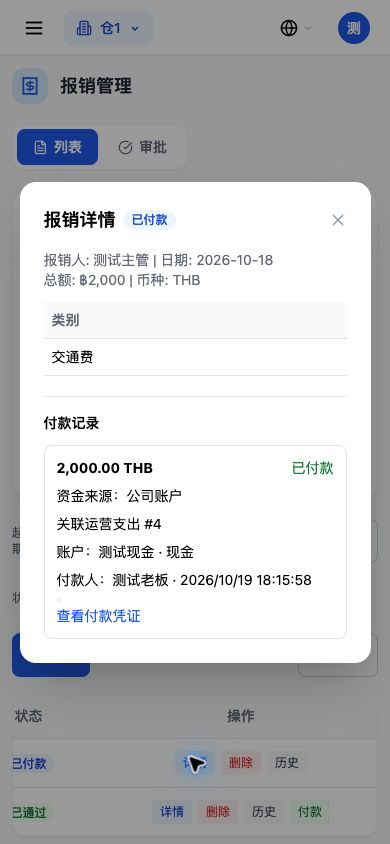
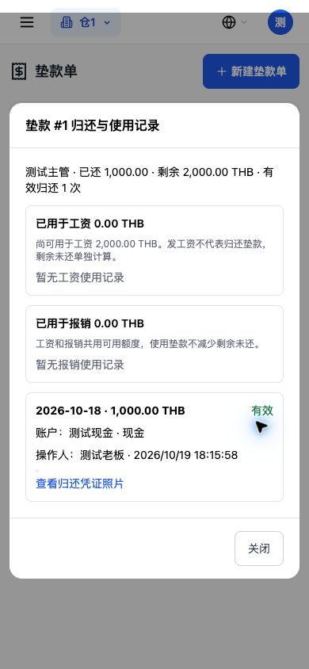
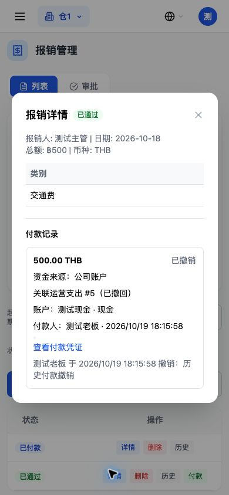
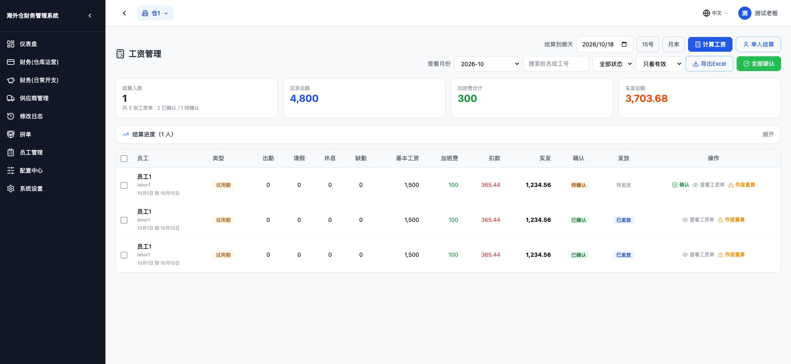

# 工资、报销、垫款归还三处撤销停用

验收日期：2026-10-19。基于 `14a0198`，全部写入验收使用本地一次性数据库，不连接生产；本轮不部署。

## 改动范围

仅停用这三个 POST 入口：

| 动作 | 接口 | 本地管理员实际返回 |
|---|---|---|
| 工资撤销发放 | `/api/v1/payroll/2/revoke-disbursement` | 400，见下方统一响应 |
| 报销撤销付款 | `/api/v1/reimbursement/1/revoke-payment` | 400，见下方统一响应 |
| 垫款撤销归还 | `/api/v1/cash-advances/repayments/1/revoke` | 400，见下方统一响应 |

三次返回体完全一致：

```json
{"detail":"撤销功能已停用 请用负数冲销记录处理"}
```

采用 **400**，表示该业务动作已停用，不是缺少角色权限。仍须有效登录，未登录保持原认证拒绝。有效登录后，在原角色判断、单据查询和任何回滚操作之前拦截；主管、财务、劳工、超管也不能绕过。没有权限、单据不存在、未填写原因，同样不能进入原撤销逻辑。

每个后端文件只增加一条引用，并在原路由注册上加停用依赖。原函数签名、函数体、角色判断、仓库隔离、事务回滚、账户恢复、成本删除、留痕等代码逐字保留；移除这两处外层改动后，三个完整文件均与基线相同。

没有修改数据库结构、历史记录或计算逻辑，没有新增冲销接口。负数冲销的登记及归属月份规则不在本轮实现。未额外写入失败尝试日志，拒绝请求不会产生业务记录或修改日志。

## 界面实际检查

三处使用统一前端停用标记，同时阻断按钮和确认弹框。即使旧 `can_revoke` 标记为真，任何角色也看不到撤销入口；保留历史状态展示。

| 页面 | 桌面实际情况 | 手机 390×844 实际情况 |
|---|---|---|
| 工资 | 已发放行没有「撤销发放」；仍有「查看工资单、作废重算」 | 所有行的操作栏没有撤销入口，确认、查看和作废重算仍按原规则显示 |
| 报销 | 已付款 2,000 的付款记录保留来源、账户、付款人、凭证，没有「撤销付款」 | 同样没有撤销入口；历史 500 的付款记录仍显示「已撤销」、原原因和时间 |
| 垫款 | 有效归还 1,000 的记录保留账户、凭证、经办人，只有「关闭」，没有「撤销这一笔」 | 同样没有撤销入口，显示已还 1,000、剩余 2,000；列表「归还」入口保留 |

未更改表格、弹框和其他页面的排版。手机截屏：







桌面工资：



## 数据和历史保护

- 专项测试先真实完成工资发放、报销付款、垫款归还，再分别尝试撤销。
- 五种角色分别调用三接口，并各试填写原因、空原因和不传请求体。每次调用前后逐表逐行比较，全部字段相同，成本、流水、账户余额和业务状态没有变化。
- 单独构造已有撤销历史：报销 2,000、归还 1,000。历史付款和归还仍为 `revoked`，金额分别为 2,000、1,000；已撤销工资仍保持原未发放状态及原金额。
- 再次调用三个停用入口后，付款历史、归还历史、工资列表、资金流水、账户查询返回及数据库全表快照均完全相同。
- 正常归还仍可执行：先归还 1,000，在三接口拒绝之后又归还 500 成功，累计已还 1,500，没有把正常归还停掉。

## 验证和测试口径

- 新增正常入口专项 8 项：五类账号统一拒绝、空/不存在记录及认证、历史读取不变、完整源码保护。该专项**没有覆盖或绕开停用依赖**。
- 旧测试中专门验证原撤销算法、失败回滚、恢复再付款的 19 个测试函数，显式使用仅测试用的 `retained_reversal_code` 依赖覆盖，继续验证用户要求保留的旧实现。此覆盖只在这些测试中生效，运行时没有恢复开关。它们不代表撤销接口仍可使用；正常入口是否关闭由上面的无覆盖专项确认。
- 原权限回归对这条已停用接口更新为统一 400；其他接口仍使用原权限和隔离断言。
- 三个前端实际组件测试通过。工资覆盖 23 组场景，包括五种角色不显示撤销；原公司账户/垫款发放、账户必选、批量付款等断言保留。报销付款、垫款归还表单原断言保留，并补验有效记录不显示撤销、历史已撤销金额正常显示。
- 前端生产构建成功，50 个页面正常生成。
- 全量后端 **1,940 项通过**（319.59 秒）；最终源码保护及停用入口复核 **9 项通过**。全量回归包含上面明确区分的正常停用入口测试和保留实现测试。

工资作废重算、报销驳回、垫款驳回、普通归还、预支、备用金及批量补卡撤销均不挂停用依赖。三个原后端文件去除新增引用和路由依赖后与基线逐字一致，工资及报销服务、账户余额、预支、备用金和打卡文件也与基线一致。
