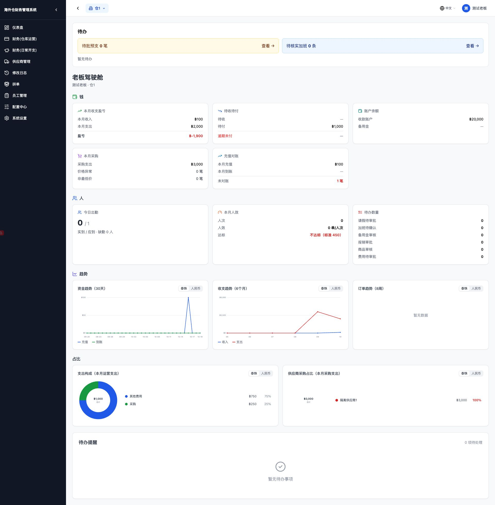
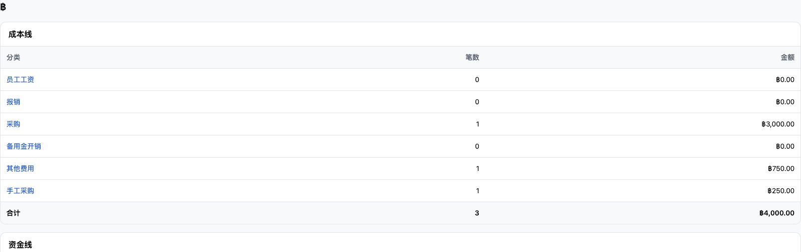
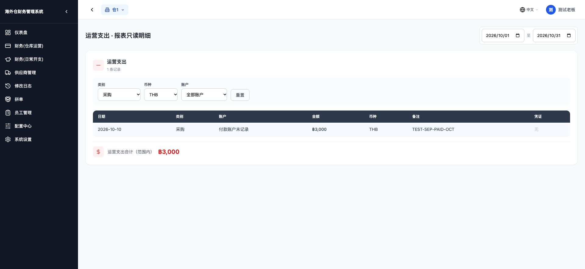

# 仪表盘采购支出按付款统计

日期：2026-10-19。基线 `7dbf327`，保留远程已有的审计查询修复。全部金额验收使用本地隔离库，不修改生产数据，不部署。

## 本轮确认的范围

初查发现报表原「采购」行来自采购类运营支出，未包含应付实付。经用户确认，本轮同时统一报表采购行；应付实付显示为「采购」，原采购类运营支出显示为「手工采购」，保留原数据和成本，不按金额、名字猜测历史关联。

仪表盘运营支出、收入、月度总支出及盈亏保持原样。采购卡片及同页的供应商采购占比改用实付口径；收入、支出趋势等其他图表保持原样。

## 共用查询和日期字段

共用函数位于 `backend/app/services/procurement_payments.py`：

- `procurement_payment_rows` 是唯一的应付实付明细查询。仪表盘采购汇总、采购供应商占比、三张账成本查询均调用它。
- 日期使用应付账单 `paid_at`，不使用 `bill_date`。生产 PostgreSQL 将付款时间转成 `Asia/Bangkok` 的业务日期，再按日期范围筛选；本月为月初至月末，包含两端。
- 金额汇总 `paid_amount`，不使用账单总额 `amount`。部分付款只取已付数，不把未付余额算进去。
- 只取本仓库、`paid_amount > 0`、`paid_at` 非空、`status != 'voided'` 的账单。保留原采购单规则：没有关联采购单，或关联采购单已确认。
- 泰铢和人民币分别汇总，不换算、不混加。

**现有数据限制：** 应付表只保存累计 `paid_amount` 和最后一次 `paid_at`，没有逐次付款明细。如果同一张账单跨月分多次支付，不能仅凭这两个字段还原每月每次付了多少；当前仍按最后付款日归属累计已付金额。本轮没有新增付款表、修改应付写接口或猜补历史。付款日期缺失的旧已付账单不猜测月份。

## 主要实际数字

隔离库验收月份：2026 年 10 月，币种：泰铢。

| 记录 | 账单日期 | 付款日期 | 账单金额 | 已付金额 | 计入十月采购 |
|---|---|---|---:|---:|---:|
| `TEST-OCT-UNPAID` | 2026-10-04 | 无 | 1,000 | 0 | 0 |
| `TEST-SEP-PAID-OCT` | 2026-09-20 | 2026-10-10 | 3,000 | 3,000 | 3,000 |

| 对照项 | 修改前 | 修改后 |
|---|---:|---:|
| 仪表盘采购支出 | 1,000 | **3,000** |
| 仪表盘供应商采购占比合计 | 1,000 | **3,000** |
| 报表「采购」行 | 250（原手工支出） | **3,000（应付实付）** |
| 报表「手工采购」行 | 未单列 | **250，原数据保留** |
| 仪表盘运营支出 | 1,000 | 1,000 |
| 仪表盘收入 | 100 | 100 |
| 仪表盘本月总支出 | 2,000 | 2,000 |
| 仪表盘盈亏 | -1,900 | -1,900 |

采购卡片、供应商占比、报表采购行均为 **3,000**。按要求，原总支出和盈亏没有随采购新口径重算；因此它们仍保留旧算法，不能把新采购卡片金额再叠加到原总支出上。

报表点「采购」打开只读明细，实际显示：1 条，日期 `2026-10-10`，金额 `฿3,000`，备注 `TEST-SEP-PAID-OCT`，合计 `฿3,000`。

## 不重复计入和只读保护

- 应付账单按单据主键一单一条只读成本明细，不生成新的 `ExpenseRecord`，不再将采购总额额外叠加进成本合计。
- 原手工采购在原记录上只改变查询展示分类，数据库分类名、金额和日期不改；仅显示于「手工采购」，不再同时占用「采购」行。
- 无关联编号的手工采购与应付付款不能可靠判定是否同一笔，按用户选择分列供核对，不自动删除或吞掉任何历史成本。
- 测试原正式支出仍是 2 条、合计 1,000；只读合并成本是 3 条、合计 4,000（其他费用 750＋手工采购 250＋应付实付 3,000），不是把采购多加两次。
- 新只读应付明细使用 `payable-<编号>` 的列表标识，避免和正式支出或旧备用金虚拟编号冲突；明细不允许编辑或删除。
- 运营支出的查询筛选文字对应显示「手工采购」，新增/编辑表单和原分类配置不改。只读应付行的说明显示「应付付款 #编号」，没有改页面排版。

## 边界与回归

- 部分付款：账单 9,000，已付 400.25，只计 400.25。
- 作废且旧已付 700、上月已付 800、下月付款 900、付款日缺失的旧已付 600、外仓付款 10,000、未确认采购单付款 500，均不进入本仓本月采购。
- 上述样本加主样本与月末付款 50 后，泰铢汇总 **3,450.25**；人民币另计 **200**。仪表盘与报表逐币种相同。
- 真实 PostgreSQL 验证 UTC→泰国时间：9 月 30 日 17:00 UTC 算 10 月 1 日；10 月 31 日 16:59:59 UTC 仍算 10 月；17:00 UTC 已是 11 月。边界样本泰铢合计 300、人民币 10.05，作废和外仓均排除。
- 仓库管理员、主管、财务三类账号均验证同一结果，保持原权限规则。
- 在相同隔离库运行旧版和新版仪表盘，除采购两个金额字段与供应商采购占比外，其余返回逐字段相同；收入、运营支出、盈亏、余额、待办、人效、收入/支出趋势保持原样。
- 每次读取前后逐表逐行快照一致，已有工资单也没有任何字段变化。
- 应付账款写接口及原统计、资金流水查询和账户余额服务与基线逐字一致，不含数据库迁移。
- 专项接口与 PostgreSQL、原报表回归 **19 项通过**；最终界面改动范围及采购专项再复核 **6 项通过**。前端报表组件测试通过。
- 全量后端 **1,946 项通过**（341.56 秒）。最后供应商采购占比与筛选显示的调整已由上述最终专项复核覆盖；前端最终生产构建成功，50 个页面生成完成。

桌面仪表盘：

报表采购与手工采购分列：

采购只读明细：

