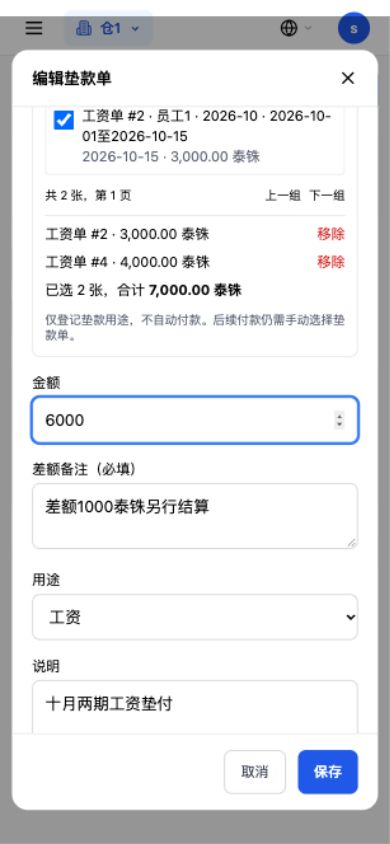
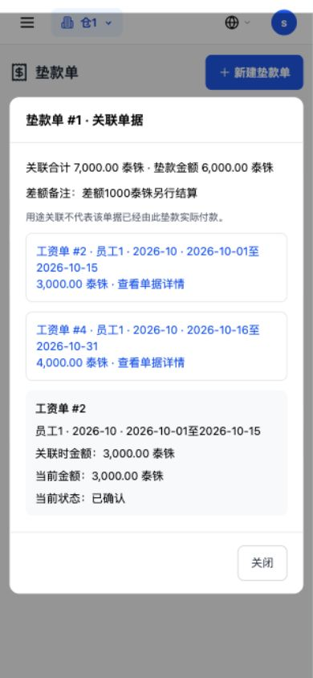

# 第九轮：垫款单关联待付单据与审核规则

2026-10-19，基线提交 `7b8b05b`。以下实操全部位于本机临时隔离库，未连接生产、未部署。

## 第一步到第四步实际结果

| 验证 | 实际结果 |
| --- | --- |
| 关联两张待发工资单 | 工资单 #2，实发 3,000 THB；工资单 #4，实发 4,000 THB。浏览器勾选后金额自动为 7,000.00 THB，保存为垫款单 #1。 |
| 修改金额不填差额备注 | 从 7,000 改为 6,000，界面拦住；直接请求也返回 HTTP 400，`垫款金额与关联单据合计不一致，请填写差额备注`。 |
| 修改金额填写备注 | 填入“差额1000泰铢另行结算”后保存成功，仍关联工资单 #2、#4，关联合计仍为 7,000，垫款金额为 6,000，状态仍为待确认。 |
| 无系统单据手写 | 管理员登记垫款单 #2，费用用途，说明“临时购买耗材，无供应商单据”，金额 600 THB，无关联单据，保存成功。 |
| 主管审核规则 | 主管创建的 #1 状态 `pending / 待确认`，确认人及确认时间为空。 |
| 管理员审核规则 | 管理员创建的 #2 状态 `confirmed / 已确认`，确认人编号为 1，确认时间已有值，公司欠款及可用金额都是 600 THB，无须再点确认。 |

浏览器实测后读取数据库，原工资、报销及明细、备用金及开销、支出、收入、预支、应付、打卡、员工这 11 张业务表逐字段快照全部相同。原工资单没有重算，关联没有触发付款、归还、成本、流水或额度占用。

逐笔返回、原始创建日志、当前列表及四类候选明细见[验收数据](垫款关联单据验收数据.json)。

## 可选范围和金额

- 工资：仅已确认、未发放、未作废且实发大于零的工资单；使用既有泰铢工资口径，金额为实发。
- 应付：待付款、部分付款或逾期且未付金额大于零，排除已付款及作废；金额为账单金额减已付金额，与现有付款口径一致。
- 报销：已通过或部分通过、尚未付款的报销；金额为审批后的报销合计。
- 预支：未结清、未驳回、未作废，包含待审批和已通过；金额为尚未随工资结清的余额。
- 四类都按本仓及同币种查询，支持分类切换、搜索及分页；跨类型选择会保留已选项，最多关联 200 张。跨币种关联、重复选择、外仓编号、已退出待付范围的编号均由后端拒绝。
- 后端保存前重新读取并锁定业务单据、计算合计，忽略客户端伪造的金额。金额不一致时必须单独填写差额备注；不关联时可以直接填金额和手写说明。
- 关联保存当时的单号、名称、日期、金额和币种快照。以后原单据金额或付款状态改变，快照仍保留，详情同时显示当前状态，不会误把用途关联当成已付款。

## 编辑规则

按用户本轮确认的范围：

- 待确认单：有垫款单权限的主管或仓库管理员可编辑。
- 已确认单：只有仓库管理员可编辑，而且必须尚未使用、尚未归还。
- 已使用过、归还过、已驳回或已归还的单据不能编辑；既有已撤销归还记录也会阻止编辑，防止更改历史账的基础信息。
- 编辑保留原审核状态、原审核人及时间；新建和编辑都记录修改日志，日志或关联写入失败会让整个请求回滚。

## 查询入口及本轮边界

- `GET /cash-advances/document-options`：按类型、币种、搜索、页码读取本仓候选，只对有权新建垫款单的角色开放。
- `POST /cash-advances`：新增 `linked_documents` 和 `amount_difference_note` 请求字段，管理员新建直接确认；主管仍待确认。
- `PUT /cash-advances/{id}`：新增编辑入口，后端锁定垫款单并按上述规则判断。
- `GET /cash-advances/{id}/documents/{link_id}`：具有垫款单查看权限的本仓账号可读取指定关联单据的快照和当前简要详情。外仓及不属于该垫款的关联编号均返回 404。
- 原列表返回增加关联单据、关联合计、差额备注及 `can_edit`；原字段保留。

垫款列表新增“关联单据”一列。点击可以看到每一张的单号和金额，再点其中一张打开准确的只读详情。手机已实际打开工资单 #2，显示关联时金额 3,000、当前金额 3,000、当前状态已确认；#4 也保留在关联列表。

**本轮只做垫款单这一侧。** 工资、应付、报销、预支四个页面没有新增反向“用途关联”显示。既有实际付款的垫款使用记录继续按原流程展示，不能把尚未执行的用途关联标成“已由该垫款付款”。没有自动选择垫款单，也没有更改这四个模块的付款接口。

## 迁移与历史

- `cash_advances` 新增可空字段 `amount_difference_note`。
- 新建 `cash_advance_documents`，记录垫款编号、仓库、单据类型/编号及关联时快照；同一垫款不能重复关联同一张单据。
- 启动脚本 `_migrate_cash_advance_documents` 中使用 `ADD COLUMN IF NOT EXISTS`、`CREATE TABLE IF NOT EXISTS`、`CREATE INDEX IF NOT EXISTS`，每一步独立保存点，失败报告并中止。
- 不给历史单据补关联，不修改历史审核状态；旧管理员创建但仍待确认的单据保持原状态。
- 真实 PostgreSQL 检查重复启动、部分迁移、三种失败后保存点恢复、唯一约束及旧工资/垫款数据保留。

## 验证汇总

- 174 项后端检查通过：关联新场景、迁移、原垫款登记/审核/归还、工资垫款、报销付款、预支资金来源及三张账。四类单据分别验证了跨仓库隐藏和拒绝。
- 两套前端检查通过：原垫款页面回归，以及新增的 12 类关联选择、金额、差额备注、编辑、明细、币种、分页和异常处理场景。
- Next 生产构建成功，50 个页面生成。沿用项目现有跳过类型/lint检查的构建配置，不将生产构建称为独立类型/lint检查通过。
- 浏览器实操覆盖主管创建、编辑差额、管理员手写创建、不同审核状态和关联详情；手机 390×844 多选可点、内容可滚动、保存成功。仅本轮新建/编辑弹框增加独立滚动容器，使长表单的标题和保存栏保持可见，没有修改全局样式、菜单和其他页面排版。
- 工资、应付、报销、预支业务接口文件与基线逐字相同；垫款确认/驳回及归还/撤销归还的业务函数与基线 AST 相同，未改变资金处理。

