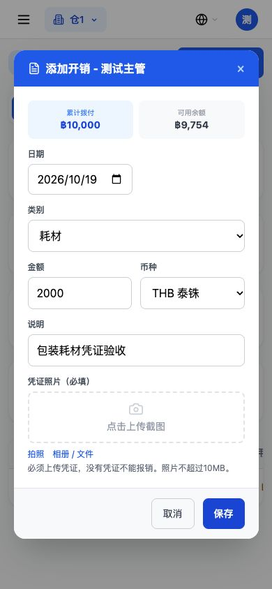
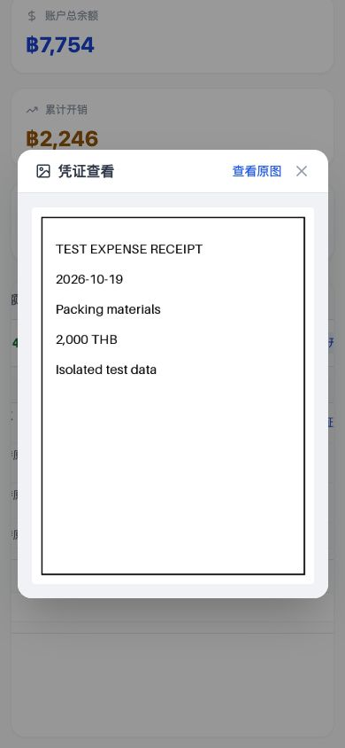

# 第十轮：备用金开销凭证强制上传

2026-10-19，基线 `14e2541`。以下验证在本机临时隔离库完成，未连接生产、未部署。

## 第一步：不传直接拒绝

向新建开销接口提交金额 2,000 THB、类别耗材和说明，不传凭证，真实返回：

```json
{"status_code":400,"body":{"detail":"请上传开销凭证"}}
```

未生成开销，不改变备用金余额、成本或资金流水。空字符串、全空格同样被拒；伪造文件路径、外仓/其他备用金账户的照片、并不存在的文件也不能作为新凭证。

## 第二步：上传后可以保存

独立接口用例先上传真实图片，再提交同一笔 2,000 THB 开销，返回 HTTP 200：

```json
{
  "id": 1,
  "message": "开销记录添加成功",
  "receipt": "/uploads/fund_receipts/1/1/5b41a80755ac4924a30d40b7c8ac0c3d.png",
  "cost_record_only": true,
  "disbursement_sources": [{"disbursement_id":1,"amount":2000.0,"label":"拨付 #1"}]
}
```

列表返回金额 2,000、耗材、待审核及同一凭证路径。审核通过返回 `{"message":"已通过1条记录"}`；开销和审核不额外新增成本、公司账户扣款或公司流水，保留原有“拨付记成本，开销只记录”的口径。

另在浏览器实际新建开销 #4：金额 2,000 THB、说明“包装耗材凭证验收”。列表与拨付明细均有“查看凭证”按钮，两处均实际打开大图，图片真实加载，原始尺寸 600×800，文件访问 HTTP 200，大小 16,531 字节。该浏览器场景预留了三条历史开销，因此新记录编号为4，与上面的独立接口用例编号1分开。

全部返回与列表字段见[验收数据](备用金开销凭证验收数据.json)。

## 审核与老数据

- 历史待审核开销 #1 没凭证，主动审核通过时返回 HTTP 400：`该开销没有凭证，请先上传开销凭证（开销 #1）`。原状态保持待审核。
- 同批包含一条有图和一条缺图的开销时，整批回滚，不会留下部分通过的结果。原驳回流程保留。
- 历史无图记录预置3条：待审核、已通过、已驳回各1条，每条123 THB。操作前后均为 **3条、合计369 THB**，逐字段完全一致，没有自动补图、改状态、删除或重算。
- 原有“给指定开销上传凭证”的接口保留：用户主动为旧待审记录补图后，可以继续审核。旧图片路径不迁移，不移动或重命名历史文件。
- 备用金审核里，由报销模块自动创建且确实关联报销单的台账继续原审核/退款流程；预支自动生成台账保留原来的专用处理限制。手工开销即使把类别填写成“报销”，也不能绕过凭证检查。

## 实现范围

- 新增 `POST /expense-fund/accounts/{account_id}/upload-receipt`：先上传，不生成开销；按仓库和备用金账户保存图片，仅仓库管理员和具有备用金权限的主管/财务使用。
- 新建开销接口要求 `receipt`，校验不能为空、属于当前账户且文件存在。金额、类别、币种、可用余额算法保留原样。
- 原指定开销上传接口继续可用。两处上传共用现有图片压缩处理，拒绝空文件、假图片及超过10MB的照片；支持 JPG、PNG、WebP、GIF，保存后缀按图片真实格式确定。
- 前端改为先上传成功再保存，上传失败不创建开销；保留错误提示及所填内容，提交过程中禁重复保存。
- 新建弹框显示“凭证照片（必填）”和“必须上传凭证，没有凭证不能报销”。新增拍照及相册/文件入口，拍照输入使用后置摄像头提示。
- 开销列表、拨付明细、原审核列表均可预览凭证，预览包含“查看原图”。预览移到两页签共用位置，避免管理页点了照片却没有弹框。
- 仅本次开销弹框增加可滚动内容及固定底部按钮；没有改全局样式、菜单或其他页面排版。
- 不增加字段或表，**无需数据库迁移**；没有历史数据回填。备用金拨付、报销、工资和预支业务代码保留原样。

## 检查结果和范围

- 101项后端检查通过，覆盖凭证强制校验、图片上传、仓库隔离、审核回滚、原备用金拨付/开销、报销付款和备用金扣款、预支资金来源。另提取一次独立接口返回用于上面的实际JSON。
- 两套前端检查通过：原备用金拨付回归和新增凭证检查，包含无照片、上传在创建前、失败不建记录、重复提交、列表/明细预览、原图链接、拍照与相册入口。
- Next生产构建成功，50个页面生成。项目构建配置沿用跳过类型/lint检查，不将构建成功当作独立类型/lint检查通过。
- 浏览器390×844实操完成选照片、上传、保存、列表和明细查看大图。桌面浏览器模拟手机尺寸，未实测实体手机摄像头；照片选择器和真实上传已验证。
- 浏览器验收库除新增的开销记录及其主动审核状态外，其余业务表逐字段保持一致；历史3条无图开销逐字段相同。
- 当前仓库代码没有独立的备用金开销删除接口或删除按钮，本轮未新增删除功能，也没有删除任何历史记录。




