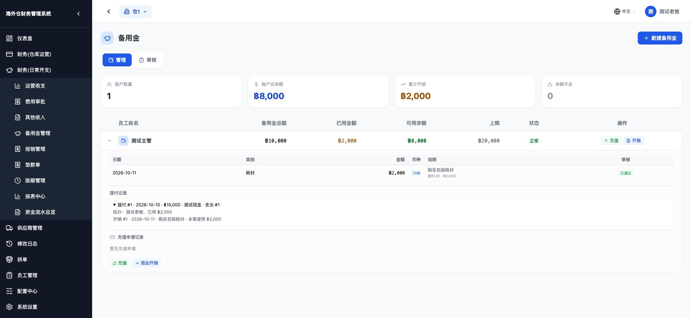

# 备用金拨付记支出，开销只记录

验收日期：2026-10-19。全部金额测试在本地隔离库中完成，没有向生产写入测试记录；本轮不部署。

## 已实现的口径

- 新拨付创建一笔「备用金拨付」运营支出，同时形成一笔公司资金流出、扣减付款账户的当前余额、增加备用金。直接充值和充值申请审批通过共用同一事务服务，任一步失败全部回滚。
- 新备用金开销保留原开销、用途、凭证、审核记录，不再进入运营支出、收支报表或资金流水。审批开销也不会再记一次支出。
- 旧开销保留旧口径，不删除、不冲账；不补录历史拨付或成本。
- 按用户确认，备用金来源的新员工预支仍由原业务代码创建、审批、工资抵扣，只在成本和资金查询中去重。数据库里的原关联支出没有被删除。
- 按用户确认，原有角色规则保留：有备用金权限的主管、财务以及仓库管理员仍可调用原直接拨付和充值审核接口。前端原有主管/财务申请充值的流程不变。

## 现状审计

修改前的代码中：

1. `cost_funds_debt.cost_query` 把已通过的备用金开销只读合并进运营支出列表、运营对比、成本资金欠款报表。
2. 普通资金流水还会显示备用金开销；普通收支报表原来只统计正式支出表，没有合并这些开销。
3. 拨付只累加备用金账户，未生成逐笔拨付或运营支出，也未扣公司账户；原资金流水使用备用金累计金额表示历史领用。

没有取得生产数据库的只读连接，因此**生产历史条数、金额尚未核实**。不能把以下测试数当成线上合计。

新增只读审计脚本 `backend/scripts/audit_fund_costs.py`，可在迁移前后运行，按仓库和币种分别列出：旧合并成本、旧开销流水、分类名带备用金的正式支出候选、已知备用金来源的员工预支支出。不按金额或名字猜测关联，不改数据库。

隔离库的历史保护测试结果：

| 项目 | 修改前 | 新拨付及新开销之后 |
|---|---:|---:|
| 旧已通过开销合并成本 | 2 条 / ฿1,500 | 2 条 / ฿1,500 |
| 旧开销流水行（包含原有状态） | 4 条 / ฿2,000 | 4 条 / ฿2,000 |
| 分类名带备用金的历史正式支出候选 | 1 条 / ฿400 | 1 条 / ฿400 |

这些项目可能从不同查询引用同一记录，不能重复相加。测试中的正式支出 400 是人工历史样本，不推断它与哪条开销有关。随后新增拨付 1,000、开销 200，合并成本从 1,900 变成 2,900，仅增加拨付 1,000；旧开销原字段逐行比较未变。

## 主要数字验收

以下使用独立空账本，现金期初 20,000，泰铢，拨付日期 2026-10-10，耗材开销日期 2026-10-11。

| 时点 | 运营支出 | 公司资金流出 | 公司现金余额 | 备用金累计拨付 | 备用金已用 / 可用 |
|---|---:|---:|---:|---:|---:|
| 操作前 | 0 条 / ฿0 | 0 条 / ฿0 | ฿20,000 | ฿0 | ฿0 / ฿0 |
| 拨付 10,000 后 | 1 条 / ฿10,000 | 1 条 / ฿10,000 | ฿10,000 | ฿10,000 | ฿0 / ฿10,000 |
| 花掉 2,000 后 | 1 条 / ฿10,000 | 1 条 / ฿10,000 | ฿10,000 | ฿10,000 | ฿2,000 / ฿8,000 |
| 开销审核通过后 | 1 条 / ฿10,000 | 1 条 / ฿10,000 | ฿10,000 | ฿10,000 | ฿2,000 / ฿8,000 |

拨付实际接口返回的关键字段：

```json
{
  "message": "充值成功，已记入运营支出",
  "disbursement_id": 1,
  "fund_id": 1,
  "expense_record_id": 1,
  "amount": 10000.0,
  "currency": "THB",
  "disbursed_date": "2026-10-10",
  "payment_account_id": 1,
  "account_name": "测试现金",
  "account_balance": 10000.0,
  "new_balance": 10000.0,
  "total_topped_up": 10000.0,
  "remark": "拨给supervisor 仓1 备用金"
}
```

开销上传真实测试图片成功。开销接口返回 `cost_record_only=true`，来源为拨付 #1、使用 2,000；拨付历史返回支出 #1、已用 2,000、开销 #1、日期、说明和凭证路径。支出列表反向返回拨付编号、备用金账户编号，并标记只读，禁止单独修改或删除联动支出。

收支报表预览、月度汇总、运营支出合并列表和成本资金欠款报表均为 10,000，没有出现 12,000。公司流水只出现拨付一笔，未重复计算关联的支出记录。

另测人民币：拨付 ¥1,000、开销 ¥200，公司账户 ¥30,000 → ¥29,000，备用金可用 ¥800；人民币成本及流出各 ¥1,000，泰铢均为 0。

## 反查和来源

- 新增逐笔拨付记录表 `expense_fund_disbursements`，支出通过 `expense_record_id` 双向关联，申请通过 `recharge_request_id` 关联。
- 备用金账户展开后可查逐笔拨付、公司付款账户、日期、经办人、支出编号、后续开销编号和分摊金额。
- 开销来源采用**只读先拨先用分摊**。它按现存有效开销重算，不是不可变的原始银行支付绑定。驳回开销不消耗分摊额度。
- 多笔实测：先拨 3,000、花 2,500，再拨 5,000、花 1,500，后一条来源为拨付 #1 的 500 和拨付 #2 的 1,000；成本和流出均为 8,000，可用 4,000。
- 原来没有逐笔编号的资金显示「历史余额（原拨付编号未记录）」或「历史来源未记录」，不伪造历史拨付编号。

## 迁移和边界

- 启动脚本新增 `expense_fund_items.cost_record_only`。迁移只将老记录的此标志设为 false，保留旧成本展示；新记录默认 true。重启不会把新记录改回旧口径。
- 新建逐笔拨付表，保存账户、币种、金额、日期、支出和申请关联；支出及申请关联分别有唯一索引。
- 每个迁移语句有独立保存点。加表加列及索引均幂等，迁移失败会打印具体步骤并阻止继续启动。
- 每个仓库按名称幂等创建「备用金拨付」运营支出分类，业务不写死分类编号；以后新仓首次拨付也会补建。
- 不指定账户、停用账户、外仓账户、币种不符或余额不足均被拒，三张账不产生部分记录。充值审批重复调用返回「该申请已处理」。
- 联动付款账户不能直接删除，可停用；避免已有拨付失去反查对象。
- 界面余额改用实际可用数，列表和弹框保持一致；报销已扣备用金余额的部分不重复扣减。拨付弹框加日期、同币种付款账户和滚动，未改其他页面排版。
- 旧账户余额接口遗漏普通收支的问题依照此前确认保留，本轮只增加备用金拨付扣减；成本资金欠款报表仍按有效流水计算。

## 回归证据

- 全量后端：**1,931 项通过**。最后补充人民币场景和可用余额断言后，最终接口专项 **17 项通过**。
- PostgreSQL 迁移专项 **10 项通过**：重复启动、旧金额/状态不变、新默认值、唯一约束及各语句故障后的保存点恢复。
- 前端真实组件测试通过：账户默认值/必选、无账户禁用、审核页能弹出付款账户、原主管申请流程、开销与凭证、双向编号、10,000/2,000/8,000 和手机滚动。
- 原成本资金欠款组件测试通过；前端生产构建成功（50 个页面）。
- 已实测三种原有操作角色；仓库范围、跨仓拒绝、多仓管理员审核、事务中途失败回滚均通过。
- 工资、员工预支、报销的接口及付款/工资抵扣服务文件与上一提交逐字节一致，原回归通过，已有工资快照未变。
- 原备用金模块没有独立单条删除接口，本轮没有新增拨付删除或撤销功能。原预支、报销关联开销的删除/恢复路径由现有回归覆盖，没有扩展其业务代码。

桌面隔离验收：



手机 390×844 验收：付款账户可选，备用金当前余额显示 8,000，按钮完整可见。


