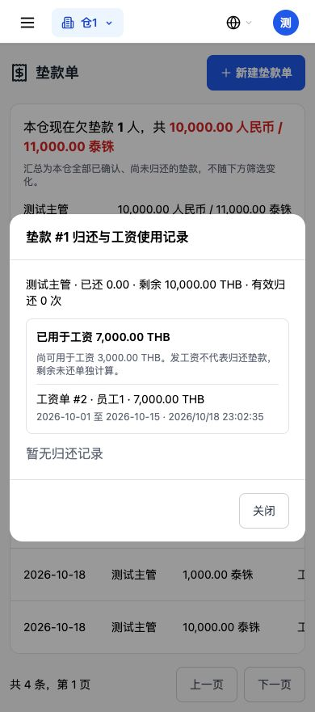
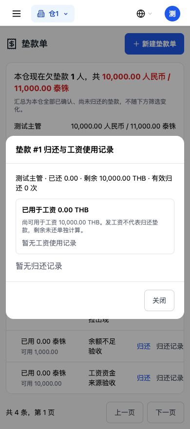

# 工资资金来源与垫款使用验证报告

验证日期：2026-10-18（泰国时间）。写操作全部在独立测试库进行，未部署、未操作生产账目。

本轮发工资增加“公司账户 / 垫款单”选择，单张和批量均支持。按用户补充确认，同时补齐原公司账户工资没有扣当前余额的问题，并限制同一垫款单累计用于工资的金额。

## 1. 垫款发工资的三个关键数字

测试工资单 `id=2`，实发 **7,000 THB**；已确认垫款单 `id=1`，金额及剩余未还 **10,000 THB**。

| 核对项 | 发放前 | 垫款发放后 | 变化 |
| --- | ---: | ---: | ---: |
| 运营支出条数 | 2 | 3 | +1 条员工工资 |
| 运营支出金额 | 750 | 7,750 | +7,000 |
| 现金账户当前余额 | 10,000 | 10,000 | 0 |
| 银行账户当前余额 | 20,000 | 20,000 | 0 |
| 资金流水总条数（含原有收入） | 3 | 3 | 0 |
| 资金流水支出合计 | 750 | 750 | 0 |
| 收支报表支出合计 | 750 | 7,750 | +7,000 成本 |

运营支出新增分类为“员工工资”的一笔 7,000，`account_id=null`，关联工资单 2、垫款单 1。垫款成本在运营支出和报表照常计算，资金流水查询排除这一笔，不动现金或银行账户。

请求：`POST /api/v1/payroll/2/disburse`

```json
{"funding_source":"cash_advance","cash_advance_id":1}
```

实际返回 HTTP 200：

```json
{
  "message": "已向 员工1 发放 7000.00 泰铢工资",
  "id": 2,
  "net_pay": 7000.0,
  "expense_record_id": 3,
  "account_id": null,
  "funding_source": "cash_advance",
  "cash_advance_id": 1,
  "disbursed_at": "2026-10-18T22:59:12.491196+07:00"
}
```

垫款单读取结果：

```json
{
  "outstanding_amount": 10000.0,
  "repaid_amount": 0.0,
  "payroll_used_amount": 7000.0,
  "payroll_unused_amount": 3000.0,
  "payroll_available_amount": 3000.0
}
```

工资使用明细为 `payroll_record_id=2`、员工1、期间 2026-10-01 至 2026-10-15、金额 7,000 THB。发工资只记使用，剩余未还仍为 10,000，公司欠款没有被当成已归还。

## 2. 撤销前后

`POST /api/v1/payroll/2/revoke-disbursement` 实际返回 HTTP 200：

```json
{"message":"已撤销发放","id":2,"reversed_expense_id":3,"reversed_cash_advance_id":1}
```

| 项目 | 撤销前 | 撤销后 |
| --- | ---: | ---: |
| 运营支出 | 3 条，7,750 | 2 条，750 |
| 垫款工资使用 | 7,000 | 0 |
| 垫款工资可用额度 | 3,000 | 10,000 |
| 垫款剩余未还 | 10,000 | 10,000 |
| 现金账户余额 | 10,000 | 10,000 |
| 银行账户余额 | 20,000 | 20,000 |
| 资金流水条数 | 3 | 3 |

工资状态退回 `confirmed`、`disbursed=false`，`expense_record_id` 和 `cash_advance_id` 都清空。支出 3 删除，当前工资使用记录不再出现；修改日志保留使用和撤销记录。实际已归还的款项不随撤销工资自动撤销，归还与工资使用是独立动作。

## 3. 额度、状态、币种与隔离

- 只有已确认、本仓的垫款单可用。待确认、已驳回、已归还和外仓单均拦住。
- 剩余未还 1,000 发 7,000，HTTP 400“垫款单剩余金额不足”。
- 已用 7,000 的 10,000 垫款单，再发 4,000 同样被拦；再发 3,000 可成功，累计使用 10,000，剩余未还仍为 10,000。撤销其中 3,000 后可用额度恢复 3,000。
- 两项额度分别校验：本次实发不能超过“剩余未还”，也不能超过“原金额减有效工资使用金额”。显示的工资可用额度取两者较小值，负数取零。发工资不修改 `repaid_amount`。
- 批量发放先按本次实际会发的工资单求和，再整体校验垫款额度；重复编号去重，已发放/作废/未确认的沿用原跳过规则。一个垫款单可用于多张工资，每张工资仍分别产生一笔员工工资成本。
- 现有工资数据结构没有独立币种字段，现有计算及发放统一为 `THB`。本轮沿用泰铢工资口径，未增加人民币工资算法。已验证人民币垫款发泰铢工资被拒；不能把此结果说成已生成并测试了人民币工资单。工资垫款下拉只列已确认、尚未还清的本仓泰铢单，人民币单的当前工资可用额度为零。
- 资金来源与参数不可混用：选垫款单不能同时传公司账户；选公司账户不能同时传垫款单。空垫款编号和无效来源同样拦住。
- 保留原工资发放角色规则：仓库管理员及有工资权限的主管可以发放，财务、劳工、超管不因此放开。只勾工资的主管也能使用本仓工资资金来源选单，不依赖另勾垫款单查询权限。
- 跨仓工资、跨仓垫款，以及混入外仓工资的批量请求均被拒，测试确认没有部分成功。

## 4. 公司账户路径与用户确认的余额修复

旧代码已记员工工资支出和资金流水，但原 `current_balance` 没有扣公司账户发出的工资。用户明确确认本轮补齐。

实际测试：

| 项目 | 公司账户发放前 | 发 7,000 后 | 撤销后 |
| --- | ---: | ---: | ---: |
| 现金账户当前余额 | 10,000 | 3,000 | 10,000 |
| 银行账户当前余额 | 20,000 | 20,000 | 20,000 |
| 运营支出金额 | 750 | 7,750 | 750 |
| 资金流水支出合计 | 750 | 7,750 | 750 |

原请求只传 `account_id` 仍然兼容，省略 `funding_source` 默认公司账户；选账户、签字照片、每张单分别入成本、撤销删除关联支出的流程继续沿用。重复发放被拒，不会再次扣余额。

账户月初余额 `opening_balance` 原值保留，当前余额由同一服务读取：

```text
当前余额 = 月初余额 - 有效垫款归还 - 已发放且关联成本的公司账户工资
```

垫款发的工资不参与公司账户扣减。撤销删除工资关联支出后，账户扣减同步解除。收款账户列表和驾驶舱账户余额共用此口径。已有公司账户工资的已关联支出也会反映在修正后的余额中；历史没有关联支出的工资不制造新支出，也不重算。其他业务的余额口径沿用原实现。

有关联已发放公司工资的账户禁止改币种，防止泰铢工资变成扣人民币余额；撤销工资后解除该项限制。原垫款归还的账户币种保护仍保留。

## 5. 字段、迁移与事务

- 工资表新增 `payroll_records.cash_advance_id`，可空、外键关联垫款单，并加查询索引。
- 支出表原 `expense_records.account_id` 为强制非空，新路径不应假挂公司账户，因此启动迁移改成可空。普通支出接口仍要求选择账户，只有垫款工资成本通过此路径写空账户。
- 新字段使用 `ADD COLUMN IF NOT EXISTS`，索引使用 `CREATE INDEX IF NOT EXISTS`；每条语句独立保存点。迁移重复执行成功，无历史金额、状态、关联重写。
- PostgreSQL 实测加列、建索引、账户可空三处分别注入失败，保存点回滚后前面迁移可继续核对；恢复后重复执行成功。旧工资关联默认为空，已有工资支出不变。
- 工资、垫款、支出使用同一请求事务和行锁。批量在第二笔成本写入时模拟失败，整批回滚；撤销日志模拟失败，支出、工资关联、使用额度全部回滚。
- 垫款登记/确认/归还仍走原逻辑。另验垫款发工资 7,000 后，再实际归还 7,000：成本仍为 7,750，现金余额变 3,000，资金流水只新增实际归还的 7,000，没有把工资成本再记成一次资金流出。

## 6. 接口与界面

- 单笔及批量发放新增 `funding_source`、`cash_advance_id`；旧字段保留。工资列表返回资金来源与垫款编号，支出列表可反查工资编号、垫款编号。
- 新增 `GET /api/v1/payroll/cash-advance-sources`，按工资权限及原发放角色校验，按仓库、确认状态和泰铢筛选。
- 垫款列表新增工资已用/可用金额。原 `GET /cash-advances/{id}/repayments` 返回新增 `payroll_usage`，点击行或记录按钮可查看每张工资单及金额。
- 前端只修改工资发放弹框、垫款单列表及其记录弹框。公司账户和垫款单各自加载与校验；公司无可用账户时仍可选择合法垫款单。
- Chrome 390×844 手机尺寸下实际执行：选垫款单、额度不足拦截、发 7,000、查看使用记录、撤销发放、查看使用额度恢复。弹框可滚动、下拉可选、底部按钮可见。





## 7. 回归范围与结果

工资计算函数与本轮基线 `0a845c3` AST 比较保持一致；考勤、报销、备用金、预支、应付代码未改。原财务数据快照除本次指定工资、成本及关联外保持一致，旧已发放工资没有自动补成本或重算。

- 本轮专项 25 项通过，包含 4 项真实 PostgreSQL 迁移测试。
- 前端发放弹框 18 个行为场景通过；垫款登记及归还组件测试通过；原主管工资标签实际接口及列表/明细 12 项检查通过。
- 前端生产构建通过。独立 TypeScript 检查仍有基线原有 101 条错误，归一化比较无新增。
- 最终完整后端回归 **1,828 项全部通过**，耗时 261.13 秒。旧范围断言更新为允许本轮资金来源改动，原计算与审批保护保留；新增选单接口加入原角色权限矩阵，覆盖全部 41 条人事工资接口。相关 289 项补跑也通过。

部署须同时更新后端和前端，确认工资垫款字段及支出账户可空迁移成功。所有验收数字与截图来自独立测试库。
