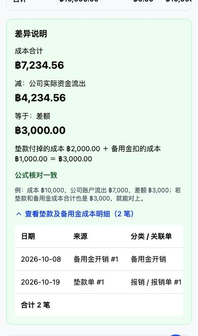

# 第五轮：成本、资金、欠款三张账

验收使用一次性本地测试库，不连接生产，不部署。此轮没有模型变更、加表加列、数据迁移或补数据。已有业务写接口及其算法保留。

## 本轮确认的口径

1. 按用户确认，备用金开销以只读虚拟明细并入运营成本列表和新报表，不创建新的运营支出记录。只计已通过的备用金开销，已驳回、待审核的不计。
2. 保留原公式：成本合计－公司实际资金流出＝差额。差额再与垫款、备用金付掉的成本核对。归还垫款、领用备用金是真实资金流出而不是当期成本，不能为了对平把它们减掉；原式不平时如实标红并解释。
3. 每个币种单独一套三张账，无跨币种合计或换算。界面只用 ฿、¥。
4. 普通运营支出、报销、工资通过成本关联编号去重；垫款支付计成本但不计公司流出，备用金开销不再作公司第二次付款，充值申报不等于实际到账。

## 第一项：四组对照数字

接口测试范围 2026-10-01～2026-10-31；浏览器默认本月截至 2026-10-19。测试记录均不晚于 19 日，两者本月数字相同。

| 对照项 | 新报表 | 同口径来源列表 / 流水计算 |
| --- | ---: | ---: |
| 运营成本合计 | ฿7,234.56，7 笔 | 统一运营支出明细 ฿7,234.56，7 笔 |
| 现金期末 | ฿6,265.44 | ฿10,000 + 流入 ฿500 − 流出 ฿4,234.56 = ฿6,265.44 |
| 银行期末 | ฿20,000 | ฿20,000 + ฿0 − ฿0 = ฿20,000 |
| 垫款未还 | ฿10,000 | 已确认垫款列表未还合计 ฿10,000 |

成本分类明细：

| 分类 | 笔数 | 金额 |
| --- | ---: | ---: |
| 员工工资 | 3 | ฿1,984.56 |
| 报销 | 2 | ฿4,000 |
| 采购 | 1 | ฿250 |
| 备用金开销 | 1 | ฿1,000 |
| 合计 | 7 | ฿7,234.56 |

工资行含测试基线原有两笔工资分类支出 ฿750，加一张实际发放的工资单 ฿1,234.56。报销两笔各 ฿2,000，一笔公司账户、一笔垫款；实际公司资金只出一次公司账户报销。

人民币另算：成本 ¥300，1 笔；人民币账户期初 ¥30,000、流出 ¥300、期末 ¥29,700；人民币银行 ¥4,000 不变。人民币账户期末合计 ¥33,700；人民币垫款未还 ¥0。

## 第二项：原公式三个数

**฿7,234.56 − ฿4,234.56 = ฿3,000。**

฿3,000 的明细为：

| 日期 | 来源 | 关联 | 金额 |
| --- | --- | --- | ---: |
| 2026-10-08 | 备用金开销 | 开销 #1 | ฿1,000 |
| 2026-10-19 | 垫款单 #1 | 报销单 #1 | ฿2,000 |
| 合计 | 2 笔 | | ฿3,000 |

差额与明细条数、金额一致，显示“公式核对一致”。人民币为 ¥300 − ¥300 = ¥0。

再归还该垫款 ฿1,000 后：成本仍 ฿7,234.56，公司流出增加为 ฿5,234.56，原式差额 ฿2,000；垫款及备用金成本仍为 ฿3,000，因此标红差 ฿−1,000。说明列出“垫款归还 1 笔，共 ฿1,000，资金流出而非本期成本”。欠款同步变成垫了 ฿10,000、已还 ฿1,000、还欠 ฿9,000。撤销测试归还后，报告完全恢复原值。

把备用金领用日期放在本期时，原式如实产生 ฿−5,000 差异，说明为备用金领用；该历史领用没有付款账户，单列未指定账户流出 ฿5,000，不猜成现金或银行。

## 日期与下钻

手机点击“上周”，实际范围 2026-10-12～2026-10-18：

- 成本 ฿750、公司流出 ฿750、差额 ฿0；人民币本期成本、流出均 ¥0。
- 现金期初 ฿10,250、本期流出 ฿750、期末 ฿9,500。开始日期前的普通收入/采购已用于推算期初，不丢掉。
- 该周登记的主管垫款仍未还 ฿10,000；欠款日期按垫款登记日期筛选，已还、未还使用当前值。
- 另测 10-05～10-11：成本 ฿1,250、公司流出 ฿250、差额 ฿1,000；此范围没有垫款登记，未还为 ฿0。人民币成本 ¥300，单独核对。

三种下钻均真浏览器验证：

| 点击 | 目标 | 筛选与结果 |
| --- | --- | --- |
| 备用金开销行 | 运营支出 | 日期、฿、备用金分类；1 笔 ฿1,000，无录入、编辑、删除按钮 |
| 测试现金行 | 资金流水 | 日期、฿、账户 #1、公司真实收付；收入 ฿500，支出 ฿4,234.56，6 条 |
| 主管姓名 | 垫款单 | 日期、฿、账号 #4；1 张 ฿10,000，未还 ฿10,000；报销已用 ฿2,000，可用 ฿8,000；无新建、确认、归还动作 |

## 只读、权限与仓库隔离

- 新报表及下钻接口均为 GET：`/reports/cost-funds-debt`、`/costs`、`/flows`、`/advances`，继承“报表中心”权限，无新增可勾权限。
- 主管、财务有报表权限可读，返回与同仓管理员相同。只有报表权限不会获得报销付款、垫款新建等写权限。
- 无报表权限、劳工、超管均被拒；管理员先选定单仓，全部仓库模式拒绝进入单仓对账。
- 外仓账号仅能看到本仓数据，不能通过仓库参数、账户编号、垫款人编号读取其他仓库。
- 全业务表读前/读后快照相同；数据库执行监听只允许 SELECT/WITH 等查询。账号、工资、报销、备用金、应付、垫款和审计记录均未变化。
- AST 比较确认运营收支原 POST/PUT/DELETE 函数未改。工资、报销、预支、备用金、应付、垫款写接口文件、模型、启动迁移均未改。

普通运营页的成本列表、支出合计和收支对比金额使用统一只读成本查询。备用金虚拟行没有写入口。原始 `ExpenseRecord` 查询接口默认兼容原结构，通过 `cost_view=unified` 启用统一视图。原有其他报表未改。

普通流水页原聚合保持不变；新下钻明确采用公司真实收付视图，避免将申报、备用金二次开销当成公司账户现金。`flow_scope=company` 和报表下钻使用同一份查询。所有金额先按分精度聚合，再分币种展示，分页不影响合计。

## 历史数据的实际限制

- 账户只有“月初余额”，没有历史月初余额快照。报表以当前月初登记值为基准，按现存有效流水推算期初和期末；不能把推算值当成已保存的历史银行余额快照。界面已说明。
- 没账户的旧到账、应付、报销、备用金领用单列“未指定账户”，不分摊给任何真实账户；没有付款日期的记录单列提示，不混进某个日期范围。
- 旧备用金领用只有累计金额及领用日期，不能推断分次充值的付款账户和实际发生时间。
- 欠款是所选日期内登记的已确认垫款的当前未还，并非历史日末快照。
- 旧账户接口 `current_balance` 尚未计入普通收支。本测试现金接口为 ฿6,765.44，按完整流水推算为 ฿6,265.44，差 ฿500（普通收支净额）；本报表按完整流水核对。该旧口径未被偷偷改动。

## 验证记录

- 报表专项覆盖精确分类/总计、各账户期末、债务、原式差异、非成本流出解释、上周/指定周、分页、同名/编号筛选、角色权限、跨仓库、无效日期和全表只读快照。
- PostgreSQL/PGlite 真实执行同一组 UNION 和日期过滤 SQL：成本 2,100，流出 2,000，流入 300；UTC 10-18 18:30 的付款按泰国 10-19 计入，不落错日；报销、备用金均未重复进入公司资金。
- 真组件测试通过公式、红色差异、明细、筛选链接、空日期、权限错误和重试。原垫款登记/确认/驳回、报销付款组件回归通过；只有报表权限的财务也能进入只读垫款下钻。
- 最终前端构建通过；原工程 101 项类型错误逐项比较无新增。最终全量后端 1,883 项通过（296.91 秒）；报表及 PostgreSQL 查询专项共 13 项通过。

[手机完整报表截图](images/three-ledgers-mobile-details.png)

[手机成本下钻：上周工资分类两笔合计 ฿750](images/three-ledgers-mobile-cost-drilldown.png)
