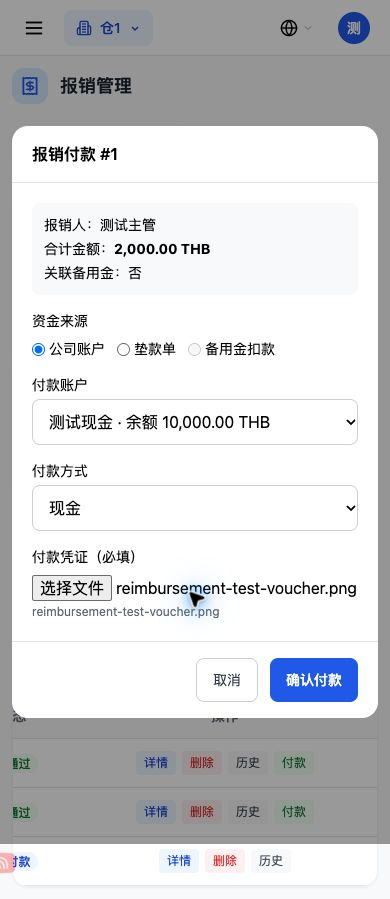
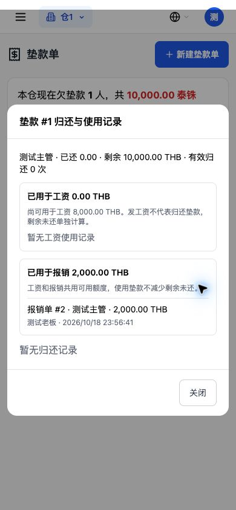
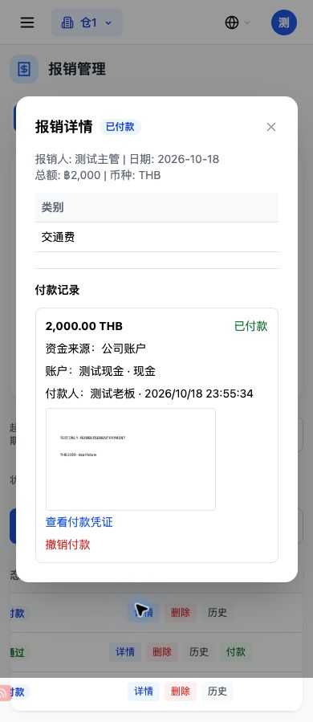
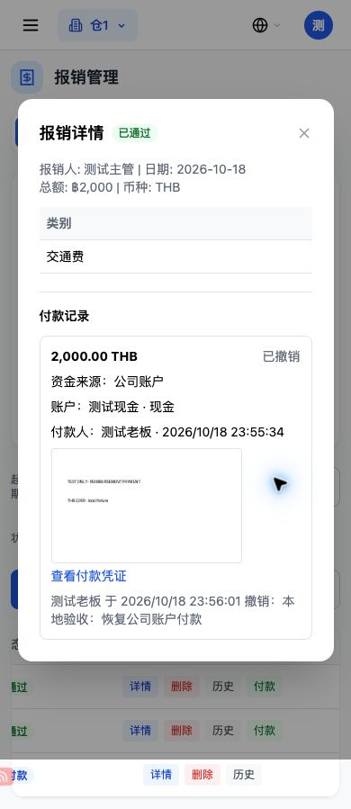
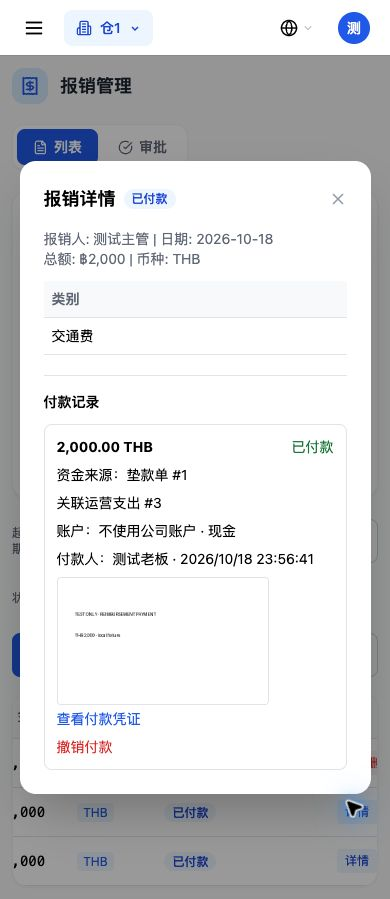
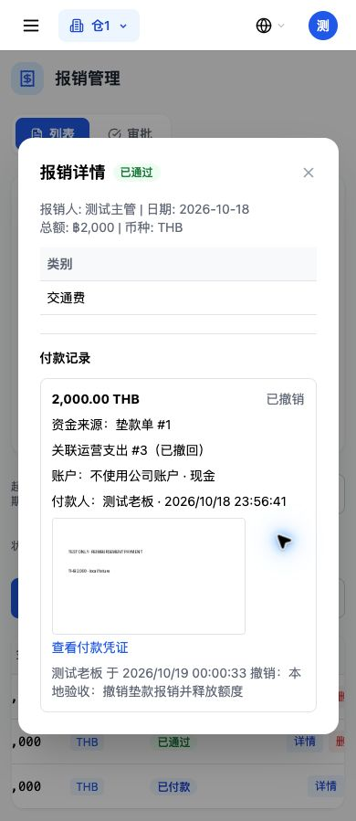

# 第四轮：报销付款成本、资金、凭证、垫款

本轮在本地一次性测试库验收，未连接生产数据库，未部署。金额单位为 THB；人民币另有独立币种用例。

## 关键实测数字

下面两条分别从干净的相同基线开始，运营支出原有 2 条、合计 750；现金 10,000，银行 20,000。

| 场景 | 运营支出 | 现金余额 | 银行余额 | 资金流水 | 垫款报销占用 |
| --- | --- | --- | --- | --- | --- |
| 公司账户付 2,000 前 | 2 条 / 750 | 10,000 | 20,000 | 4 条 | 0 |
| 公司账户付 2,000 后 | 3 条 / 2,750 | 8,000 | 20,000 | 5 条，仅新增一条 2,000 | 0 |
| 撤销公司账户付款 | 2 条 / 750 | 10,000 | 20,000 | 原付款行保留，标已冲销，不再计入支出合计 | 0 |
| 垫款付 2,000 前 | 2 条 / 750 | 10,000 | 20,000 | 4 条 | 0 |
| 垫款付 2,000 后 | 3 条 / 2,750 | 10,000 | 20,000 | 仍为 4 条 | 2,000 |
| 撤销垫款付款 | 2 条 / 750 | 10,000 | 20,000 | 仍为 4 条 | 0，当前使用记录为空 |

垫款单金额 10,000，报销使用 2,000 后，可用额度 8,000，剩余未还仍为 10,000。工资和报销共用可用额度，两个方向都验了，不能把同一笔垫款重复花掉。归还垫款仍只动资金，不再追加报销成本。

## 第一项：公司账户付款返回

```json
{
  "message": "付款成功",
  "id": 1,
  "status": "paid",
  "expense_record_id": 3,
  "cash_advance_id": null,
  "account_balance": 8000.0,
  "payment": {
    "id": 1,
    "amount": 2000.0,
    "currency": "THB",
    "funding_source": "company_account",
    "payment_account_id": 1,
    "cash_advance_id": null,
    "expense_record_id": 3,
    "paid_by_id": 1,
    "paid_by_name": "warehouse_admin",
    "paid_at": "2026-10-18T23:57:49.342172+07:00",
    "status": "active",
    "ledger_ref_no": "RB-P-1"
  }
}
```

该运营支出分类为“报销”，接口返回 `reimbursement_id=1`，报销详情与付款历史返回 `expense_record_id=3`，双向可查。付款凭证真实上传后校验文件存在及仓库归属。付款再点一次返回 400，支出仍只有一笔。不传凭证返回 400 `请上传付款凭证`；账户为空、停用、异仓或币种不符都被拒。

公司账户沿用前轮余额口径：`current_balance` 从月初余额扣除有效归还、公司账户工资及本轮公司账户报销计算，撤销自动恢复；不把“月初余额”覆盖成付款后的余额。

## 第四项：垫款付款返回

```json
{
  "message": "付款成功",
  "id": 1,
  "status": "paid",
  "expense_record_id": 3,
  "cash_advance_id": 1,
  "account_balance": null,
  "payment": {
    "id": 1,
    "amount": 2000.0,
    "currency": "THB",
    "funding_source": "cash_advance",
    "payment_account_id": null,
    "cash_advance_id": 1,
    "expense_record_id": 3,
    "paid_by_id": 1,
    "paid_by_name": "warehouse_admin",
    "paid_at": "2026-10-18T23:57:49.663913+07:00",
    "status": "active",
    "ledger_ref_no": null
  }
}
```

垫款必须本仓、已确认、同币种，既不能超过剩余未还，也不能超过扣除工资和报销占用后的可用额度。额度不足返回 400 `垫款单剩余金额不足`。未确认、异仓、异币种均被拒，无成本或资金残留。

## 第六项：撤销

公司账户撤销返回 `status=approved, expense_record_id=null, account_balance=10000`，原成本删除，原付款历史与流水保留已撤销/已冲销状态，记录撤销人、时间、原因。

垫款撤销返回 `status=approved, expense_record_id=null, cash_advance_id=null`，原成本删除，垫款当前报销使用为空，可用额度恢复；审计付款历史保留撤销记录。

仅仓库管理员可撤销。主管、财务、劳工、超管都返回 403；主管/财务为 `只有仓库管理员可以撤销报销付款`。空原因返回 400 `请填写撤销原因`。跨仓库不能付款、查付款来源、上传凭证、查记录或撤销。

## 备用金路径

新建关联备用金报销时的原扣款块逐句未改，AST 比较与本轮前完全一致。

| 动作 | 备用金余额 | 公司账户 | 新增运营支出 | 付款新增资金流水 |
| --- | --- | --- | --- | --- |
| 原余额 | 5,000 | 不变 | 0 | 0 |
| 按原规则创建 2,000 关联报销 | 3,000 | 不变 | 0 | 0 |
| 本轮付款确认 | 仍 3,000 | 不变 | 0 | 0 |
| 撤销付款 | 5,000 | 不变 | 0 | 0 |
| 再次付款 | 3,000，只扣回原退款 | 不变 | 0 | 0 |

备用金原有资金流水来自备用金自身记录；报销付款不再额外生成第二笔。撤销恢复原备用金开销实际扣掉的金额，删除对应开销，留存原开销快照，避免重复退款及再次付款时重复扣款。

原备用金批量审核也会直接把报销变成已付款，因此在原审核成功处补付款历史和资金来源，并加与付款相同顺序的行锁；原审批条件、扣退款金额和状态规则保留。实测原审核通过后仍为 3,000，驳回或撤销后恢复 5,000；重复审批/退款不重复发生。

此前询问的两个边界按已说明的默认方案实现：历史无账户的已付款单保持只读、不推断、不补成本、不允许新撤销；备用金原审核补最小付款历史同步。

## 数据库及接口

启动迁移中每个 DDL 使用独立保存点，`IF NOT EXISTS`，失败抛出，避免缺表缺列时继续启动。

- 报销单新增：`payment_account_id`、`payment_voucher_path`、`funding_source`、`cash_advance_id`、`expense_record_id`；`payment_method` 沿用旧字段，迁移仍兼容缺列的旧库。
- 新增 `reimbursement_payments`，23 列，保存每次付款和撤销的独立历史、付款人、凭证、备用金原开销快照。有效付款有唯一约束，避免同一报销重复付款；撤销历史不删除。
- 每仓幂等补“报销”运营支出分类，新仓初始化也有该分类，不写死分类编号。
- PostgreSQL/PGlite 真实执行迁移两遍，13 个 DDL 分别注入失败，保存点外的前序工作保留；历史已付款报销原值、账户月初余额、老成本均不变。付款后再次迁移也不改付款或撤销历史。

接口都使用“报销管理”权限并保留仓库归属校验：

| 方法与地址 | 用途 |
| --- | --- |
| GET /reimbursement/payment-sources?reimbursement_id=… | 本仓同币种账户与已确认垫款，返回余额/可用额度 |
| POST /reimbursement/payment-voucher | 上传本仓付款凭证，校验图片、大小与文件路径 |
| POST /reimbursement/{id}/pay | 三条资金来源，成本/付款/状态共用一次请求事务 |
| GET /reimbursement/{id}/payments | 每次付款与撤销历史 |
| POST /reimbursement/{id}/revoke-payment | 仓库管理员按原资金来源撤销 |

旧列表/详情增加付款字段；运营支出返回报销编号；垫款列表与详情增加报销使用金额和明细。联动成本不能通过普通支出编辑/删除绕过报销撤销；有付款历史的报销不允许硬删，已付款不能再次提交审批制造第二笔成本。

## 回归与手机

- 最终全量后端回归 1,870 项通过，耗时 287.30 秒；其中报销及 PostgreSQL 迁移专项 42 项通过，包含小数合计/部分通过用例。其余工资、考勤、账号、预支、应付等既有用例通过。
- 三种来源付款、撤销分别注入写日志失败，全部事务回滚，无残留成本、扣款、占用或错误状态。
- 普通工资支付/撤销业务代码、工资计算/考勤计算未改；仅共用垫款额度和工资资金来源查询扣除新增报销占用，避免交叉复用。
- 工资、预支、备用金、应付旧记录做快照对比；报销公司账户/垫款付款与撤销不改这些旧记录。老已付款报销不补成本、不补账户、不自动改状态；不自动重算任何工资单。
- 小数明细 0.1+0.2，另 5 元被驳回，按批准合计 0.30 付款，现金 10,000→9,999.70，撤销恢复 10,000，状态恢复部分通过。
- 真组件测试覆盖三条来源、默认现金、必传凭证/账户、额度不足、上传失败、历史只读、管理员撤销原因、刷新、垫款报销明细。垫款登记/确认/驳回和归还/撤销真组件回归通过；既有工资发放 18 个场景通过。
- 390×844 真浏览器：备用金付款、公司账户上传→付款→查看记录→撤销、垫款上传付款和使用记录均已实测。公司账户撤销后本地现金为 10,000、银行为 20,000；垫款报销使用 2,000、可用 8,000、剩余未还 10,000。
- 最终前端生产构建通过；类型检查仍为原工程 101 项错误，与基线逐项比较无新增，本轮不修无关错误。

界面仅增加报销付款弹框/记录/撤销、垫款报销使用展示和报销详情弹框手机滚动；未改其他页面排版。












