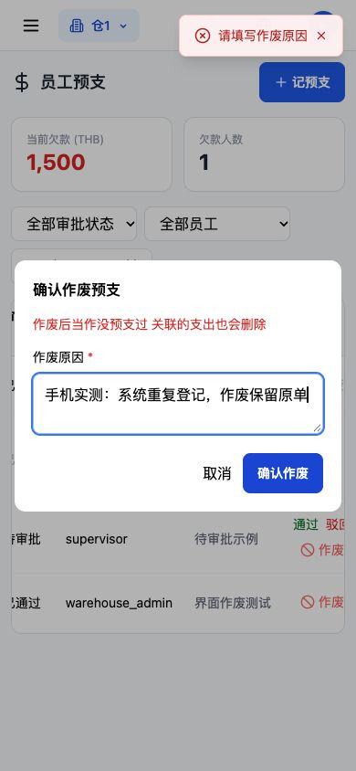
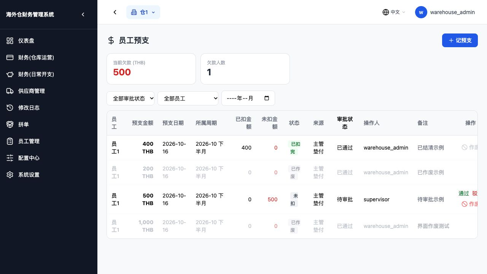

# 预支不能硬删，改为作废留痕

日期：2026-10-19。基线：`d50a8bc`。本轮只处理预支删除这条路及其必要联动；没有部署，没有操作生产数据库，也没有重复跑上一轮工资上限的28项数值专项。

## 接口与字段

保留原地址 `DELETE /api/v1/employee-advances/{id}`，但动作改成作废，必须发送原因：

```json
{"void_reason":"测试登记有误"}
```

账号角色必须为 `warehouse_admin`。主管、财务、劳工和超管均返回403：

```json
{"detail":"只有仓库管理员可以作废预支"}
```

新增3个可空字段，启动迁移使用 `ADD COLUMN IF NOT EXISTS`，每列独立保存点；失败抛出异常，不带缺字段继续启动。迁移不更新老记录，老数据三个字段都是NULL。

| 字段 | 含义 |
|---|---|
| `voided_by` | 作废人账号编号 |
| `voided_at` | 作废时间 |
| `void_reason` | 作废原因，最多500字 |

预支 `status` 新增值 `voided`。原金额、日期、原审批结果保留。作废状态或作废时间任一存在，该记录均不再作为有效预支。

## 第一步：作废及支出条数

主验收使用本地独立数据库，先登记已通过预支1,000，关联运营支出1条、金额1,000。填写原因后，HTTP200实际返回摘录：

```json
{
  "message": "预支已作废",
  "id": 1,
  "status": "voided",
  "remaining_amount": 0,
  "approval_status": "approved",
  "expense_record_id": null,
  "is_voided": true,
  "voided_by": 1,
  "voided_at": "2026-10-19T20:43:04.194705+07:00",
  "void_reason": "测试登记有误"
}
```

作废后、再新建额度测试单之前：

| 项目 | 作废前 | 作废后 |
|---|---:|---:|
| 原预支行数 | 1 | **1** |
| 原单金额 | 1,000 | **1,000，保留留痕** |
| 关联运营支出条数 | 1 | **0** |
| 关联运营支出金额 | 1,000 | **0** |

支出删除写入 `expense / delete` 修改日志，保存原金额、币种、员工和预支编号，原因是“作废预支：测试登记有误”。预支本身写入 `employee_advances / void`，记录操作者、原状态、原支出编号以及作废后的状态、时间、原因。

预支作废、关联成本删除、精确关联的备用金开销清理及日志都用同一个事务。分别模拟支出日志失败、预支作废日志失败，整笔均回滚，原单、支出、备用金开销及工资快照不变。

## 第二步：数据库原单仍在

另用真实浏览器完成手机作废后，直接只读查询该界面隔离库，实际结果：

```text
id                  1
amount              1000.0
status              voided
approval_status     approved
deducted_amount     0.0
expense_record_id   NULL
voided_by           1
voided_at           2026-10-19 20:51:35.986857
void_reason         手机实测：系统重复登记，作废保留原单
```

这个界面库共有4条示例预支，作废后仍为4条。它另外保留一笔400的已结清示例支出和一笔500的待审批示例，所以支出从 **2条、1,400** 变为 **1条、400**，当前欠款汇总从 **1,500** 变为 **500**。这是截图所用的独立示例库，与上面的单笔主验收场景分开。

## 第三步：作废后不占额度

主验收员工月工资标准10,000。作废原1,000后，下一笔登记返回：

```json
{
  "limit_check": {
    "checked": true,
    "currency": "THB",
    "monthly_salary": 10000.0,
    "occupied_amount": 0.0,
    "requested_amount": 10000.0,
    "available_amount": 10000.0,
    "remaining_amount": 0.0
  }
}
```

可用额度完整恢复为 **10,000**，新登记10,000成功。这是新单，未恢复或覆盖原作废单。上轮工资标准、待审批占用和汇率算法未改，额度查询只多一个排除作废条件。

## 第四步：作废后不抵扣工资

另一个隔离工资场景：日薪400、正常打卡3天，先登记1,000再作废，之后人工算工资。实际结果：

| 工资基数 | 预支扣款 | 实发 |
|---:|---:|---:|
| **1,200** | **0** | **1,200** |

工资明细 `advance_deductions=[]`，作废预支不参与抵扣。作废动作本身没有重新计算任何旧工资，旧工资单快照保持一致。

工资预支查询只增加排除作废及行锁，防止算工资和作废同时操作同一笔时互相覆盖状态；原FIFO抵扣、金额、结转和工资公式保持原样。通过去掉这两处明确改动后与原版本逐字／逐函数比较验证。

## 第五步：扣过工资的不能作废

按本轮追加确认，**凡已扣过工资都不能作废，包括部分抵扣**。

| 场景 | 作废结果 |
|---|---|
| 预支1,000，工资已扣清1,000，实发200 | HTTP400：`该预支已随工资结清 不能作废` |
| 预支2,000，工资已扣1,200，尚余800 | HTTP400：`该预支已随工资抵扣 不能作废` |

拒绝前后的预支、支出、日志和工资逐字段一致，没有删除成本、回退工资或解除原欠款。

除了检查结清状态和已抵扣金额，还核对仍保留的工资扣款明细；即使累计计数异常归零，或原工资已经作废但仍保留了扣款明细，查到扣过该预支也会拒绝。

## 必要联动与界面

- 原审批结果不篡改为已驳回。正常审批流程不改；仅对已经作废的单拒绝再次通过／驳回，防止重新生成支出。
- 作废的待审批单从老板待办消失，实测条数 **1→0**。预支汇总和员工自己的欠款也排除作废；列表保留原单，未还金额显示0。
- 前端仅替换删除入口为管理员专用的作废按钮，增加原因确认框和灰色已作废标记；原表格结构、顺序、其他表单不改。已作废无操作按钮，已结清／部分抵扣的作废按钮不可点。
- 精确关联的备用金预支开销随作废清理，不凭姓名、金额猜删历史开销；备用金接口和其他业务模块的写逻辑未改。
- 有明确支出关联的记录即使旧追踪标记为false，也删除该已知成本；没有关联成本的历史预支不猜补成本。过去已经硬删的预支不重建。
- `api.delete` 仅增加可选的JSON请求体以发送原因；原来不带请求体的其他删除请求保持不带请求体，并有组件测试覆盖。

手机视口390×844实测：弹框宽358、高275，两个按钮都在可见区域，底边539.5；支持内部滚动。空原因被拦，填写后实际提交成功，原单留在列表、变灰、按钮消失。截图中的空原因提示是先尝试空提交后的验证提示，随后填写原因并确认成功。





## 验证范围

本轮作废专项26项、真实PostgreSQL迁移8项、相关回归134项，共 **168项不同检查通过**。覆盖作废事务、权限、跨仓拒绝、审批、工资计算／确认／发放／作废／重算、备用金联动、待办和历史保护。迁移验证逐列失败只回滚保存点，重复执行不改旧数据或已作废记录。

前端作废交互和原选人组件测试通过，最终生产构建成功，50个页面生成完成。按仓库原构建配置跳过类型检查和lint，此处不将它们单独计为通过项。手机验证使用真实浏览器的手机尺寸视口，不是实体手机。

所有写操作均发生在临时隔离数据库。线上数据库尚未执行本轮三列迁移；部署时由现有启动脚本执行。本轮不部署、不自动重算历史工资、不修复已删除的历史预支。
