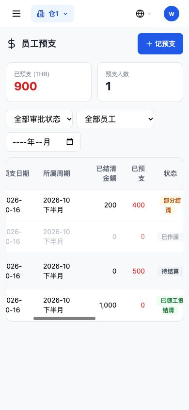
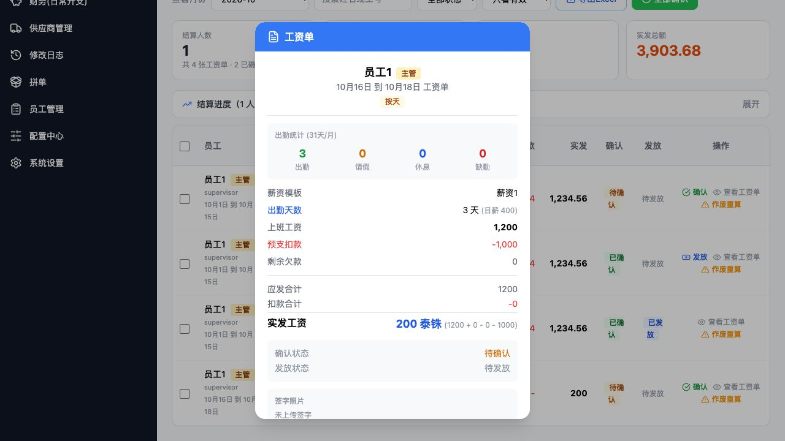
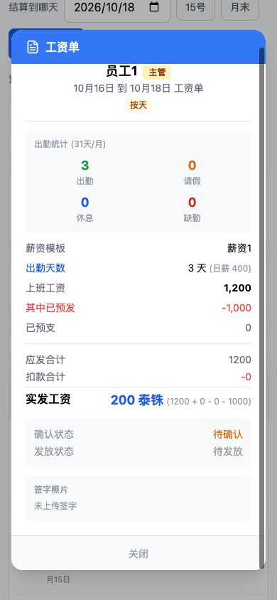
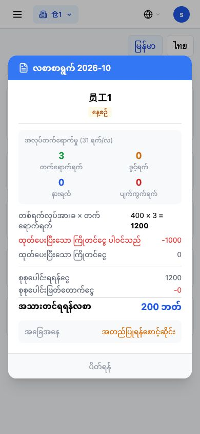
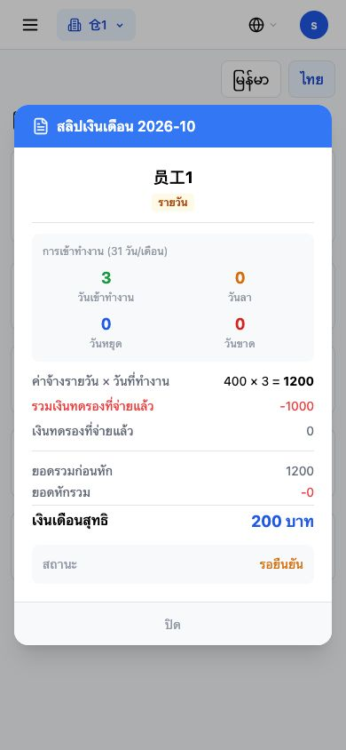
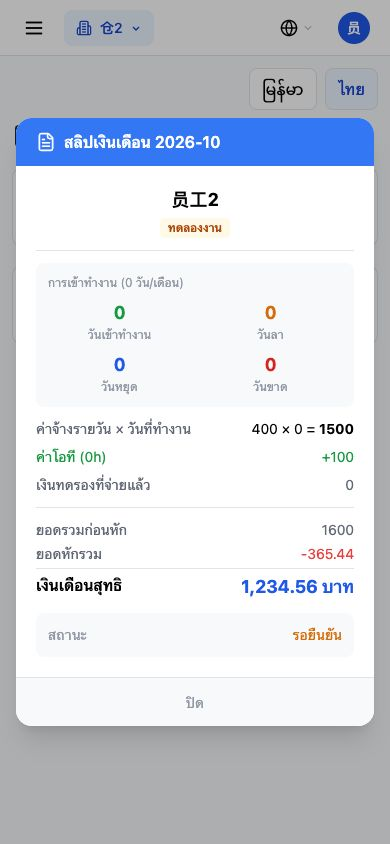
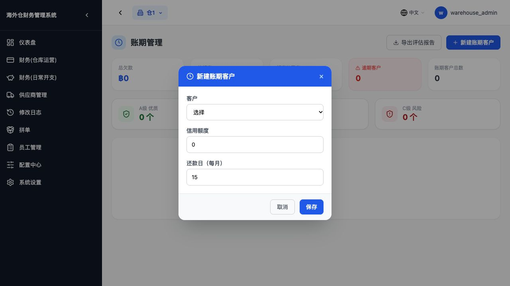
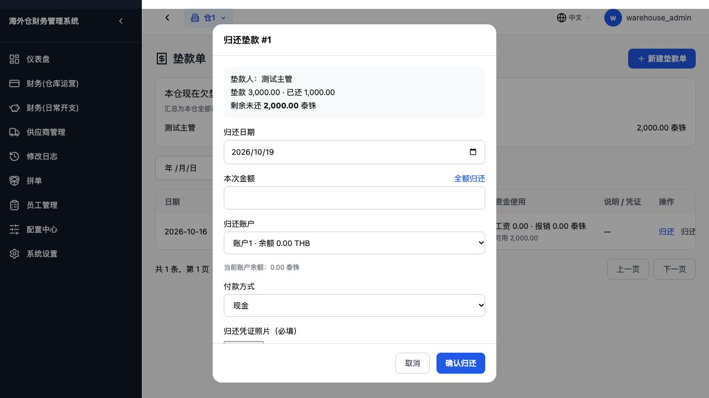

# 预支剩余用词清理验证报告

日期：2026-10-19。基线提交：94ae832。本轮在本机隔离数据库验收，不操作生产、不部署。

## 修改内容及范围

业务文件仅六个：员工预支页面、管理端工资单页面、三份语言字典，以及后端工资导出的列头。只替换显示文字，共十二行；没有修改样式、布局、金额表达式、字段名、状态值、接口地址、数据表、迁移或计算规则。

| 位置 | 旧文字 | 新文字 |
| --- | --- | --- |
| 员工预支汇总人数 | 欠款人数 | 预支人数 |
| 员工预支状态 `unpaid` | 未扣 | 待结算 |
| 员工预支列表 | 已扣金额 | 已结清金额 |
| 管理端、员工端工资单及工资导出 | 剩余欠款 | 已预支 |
| 管理端、员工端工资单及工资导出 | 预支扣款 | 其中已预发 |

预支列表的“未扣金额”在上一轮已改成“已预支”，本轮保持。原有“部分结清 / 已随工资结清 / 已作废”不变。工资导出也只改两个列名，原列顺序、数值表达式和 Excel 金额值均保留。

## 第一步：管理端实际显示

管理员真实登录：汇总“已预支 (THB) 900”和“预支人数 1”；表头“已结清金额”“已预支”；未结清示例的状态为“待结算”。部分结清示例原金额 600，已结清金额 200，已预支列 400；已随工资结清的 1,000 元示例仍显示已结清金额 1,000、已预支 0。

[管理端桌面截图](images/advance-terms-advance-desktop.jpg)

## 第二步：工资单改名前后

在同一个临时数据库、同一张实际计算的工资单 #11 上，先启动基线前端，再换成本轮前端。期间只读取这张单，没有重算或改数据。

| 项目 | 改名前 | 改名后 |
| --- | --- | --- |
| 上班工资 | 1,200 THB | 1,200 THB |
| 指定行完整显示 | 预支扣款 -1,000 | 其中已预发 -1,000 |
| 后一行 | 剩余欠款 0 | 已预支 0 |
| 实发工资 | 200 THB | 200 THB |

该行 DOM 原为 `
预支扣款-1,000
`；改后仅第一个 span 的文字变成“其中已预发”。金额 span、父元素样式、上一行“上班工资”和下一行的位置完全相同。负号原样保留。

导出实测：列头“其中已预发”对应 Excel 数值 1000，“实发”仍为 200，“已预支”对应 0。与数据库原字段值一致，没有改变导出的数值正负号口径。

## 第三步：员工端实际文字

| 中文 | 缅语 | 泰语 |
| --- | --- | --- |
| 其中已预发 | ထုတ်ပေးပြီးသော ကြိုတင်ငွေ ပါဝင်သည် | รวมเงินทดรองที่จ่ายแล้ว |
| 已预支 | ထုတ်ပေးပြီးသော ကြိုတင်ငွေ | เงินทดรองที่จ่ายแล้ว |
| 我的预支（上轮已完成，保持） | ကျွန်ုပ်၏ကြိုတင်ငွေ | เงินทดรองของฉัน |

沿用原字典的“预支”用词 `ကြိုတင်ငွေ` / `เงินทดรอง`，搭配原“已发放” `ထုတ်ပေးပြီး` / `จ่ายแล้ว`，只用普通连接词表达“其中”。未创建新的业务术语或字典键。

员工端现有页面实际只涉及“其中已预发”“已预支”这两项；“预支人数、待结算、已结清金额”只存在于中文管理页，没有对应的员工端栏目，本轮不增设栏目或无用字典键。员工端原本只提供缅语和泰语切换，不新增中文入口；中文对应值已核对字典。

实际用纳入考勤的主管登录员工端，缅语和泰语的两行金额均为 -1000 与 0，实发仍为 200；普通劳工 labor2 的工资单也可打开，泰语“已预支”行显示 0，原实发 1,234.56 不变。预发金额为零时，原逻辑仍不显示“其中已预发”行，没有改变显示条件。

## 第四步：明确不改的文字

- 客户账期实际页面：“总欠款”“逾期客户”“还款日（每月）”仍在。客户详情中的“当前欠款、还款记录”源文件原样保留。
- 垫款实际页面：“部分归还”“归还”“归还记录”“剩余未还”仍在。打开归还弹框显示“垫款 3,000.00 · 已还 1,000.00”“剩余未还 2,000.00 泰铢”。仅打开查看，没有提交归还。
- 客户档案、账期管理、垫款列表、归还弹框和归还历史组件逐字对比基线一致。垫款资金来源提示“公司账户未扣款”等也保留，它们描述公司资金动作，不是预支结算状态。

## 功能与手机检查

- 47 项后端隔离回归通过：预支新建、审批、驳回、作废、结清保护、工资预支抵扣、确认、发放、手动重算及历史工资保护。
- 原有四套前端检查通过：`employee-advance-void.test.cjs`、`advance-manager-recipients.test.cjs`（15 项）、`payroll-disbursement.test.cjs`（23 场景）、`cash-advance-repayments.test.cjs`。
- 逐字还原本轮文案后，两个前端页面及后端导出文件与基线完全一致；三份字典仅两个显示值有变化，全部键及其他值不变。员工端页面源码本身未修改。
- 界面改名前后，隔离数据库中 5 张既有工资单逐字段快照一致，包含金额、明细和状态。没有执行自动重算。
- Next 14.2.35 生产构建成功，50 个页面生成。原项目配置跳过类型校验和 lint；不将构建等同于独立类型/lint 检查。
- 手机 390 × 844：预支列表维持原有横向滚动；中文工资单、缅语和泰语工资单的标签与金额完整，没有遮住金额。长文字按原样式自然换行，没有改排版或样式。
- `git diff --check` 通过。本轮不新增迁移，不更改任何生产记录。
