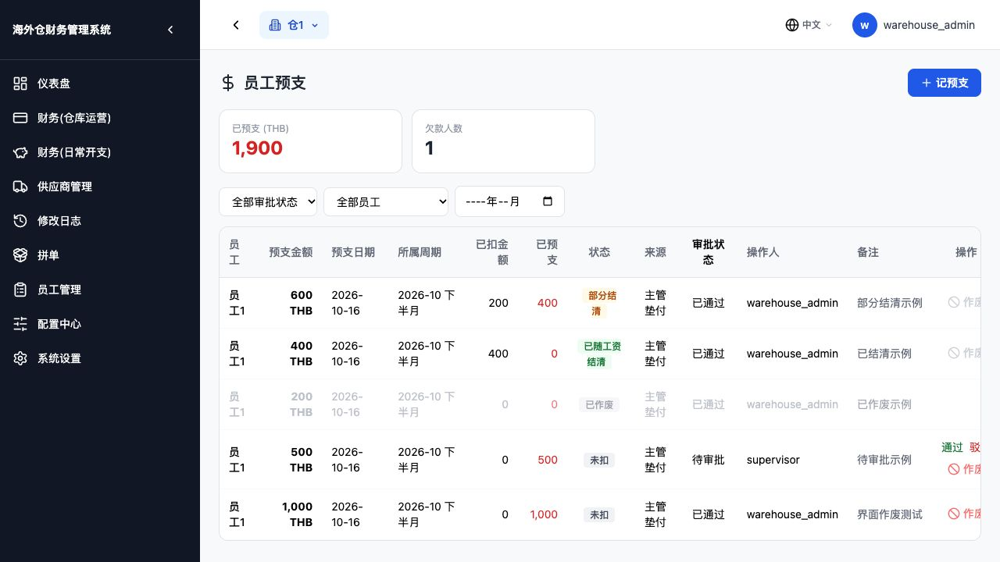
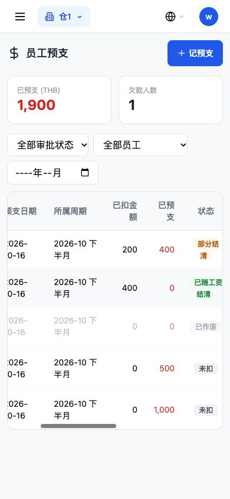
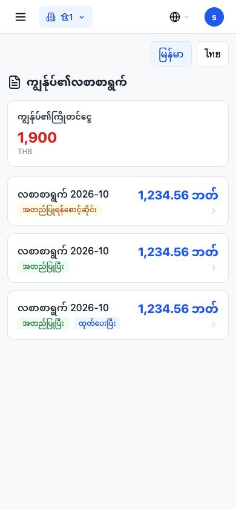
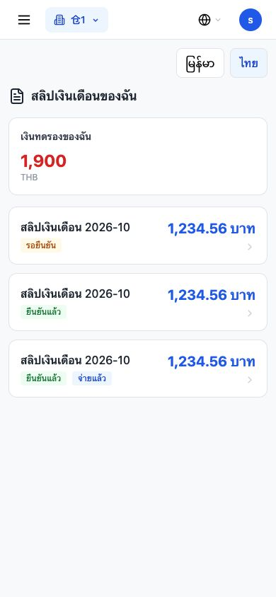

# 预支显示文字改为工资分期用词

验收日期：2026-10-19。基线：e1e0be7。仅本地隔离库验证，未操作生产、未部署。

## 修改范围

业务源文件仅四个：员工预支页面及中文、缅语、泰语字典。共替换七行文字；不改 CSS、结构、事件处理、字段、接口、菜单、业务判断、数据库及迁移。

| 位置 | 修改前 | 修改后 |
| --- | --- | --- |
| 预支汇总（有币种、空列表两种分支） | 当前欠款 | 已预支 |
| 预支列表剩余金额列 | 未扣金额 | 已预支 |
| 结清状态标签 | 已扣完 | 已随工资结清 |
| 部分结清状态标签 | 部分扣 | 部分结清 |
| 中文 `my_debt` | 我的欠款 | 我的预支 |
| 缅语 `my_debt` | ကျွန်ုပ်၏ကြွေး | ကျွန်ုပ်၏ကြိုတင်ငွေ |
| 泰语 `my_debt` | หนี้ของฉัน | เงินทดรองของฉัน |

原代码中该列表列头实际叫“未扣金额”，对应 `remaining_amount`，不是提示词中的“剩余欠款”。只将其标题改为“已预支”，数值仍按原字段显示。工资单明细中的“剩余欠款”另列入待确认清单，未擅改。汇总也仍按原剩余金额计算，未改成累计历史预支总额。

缅语用原字典 `employee_advances` 中的 `ကြိုတင်ငွေ`，搭配原“我的”前缀 `ကျွန်ုပ်၏`；泰语用原字典中的 `เงินทดรอง`，搭配原“我的”后缀 `ของฉัน`。没有另造业务术语，也没有改字典键。`advance_deduction` 的三种语言及工资单“预支扣款”均原样保留。

## 实际显示结果

管理员实际登录本地完整构建：汇总“已预支 (THB) 1,900”，表头“已预支”；600 THB 的部分结清示例显示“已扣金额”200、剩余 400、状态“部分结清”；400 THB 的结清示例显示剩余 0、状态“已随工资结清”。新旧数值字段和样式一致。

员工自助页实际使用已纳入考勤的主管账号登录，分别点击原有的缅语、泰语切换：标题为 `ကျွန်ုပ်၏ကြိုတင်ငွေ` / `เงินทดรองของฉัน`，两边都显示同一金额 1,900 THB。原员工端只提供缅语和泰语，不新增中文入口；中文“我的预支”通过使用真实字典的页面组件渲染核验。

手机尺寸 390 × 844：管理端保持原有表格内横向滚动，长状态正常换行，标签未被截断；两种员工语言标题完整、金额可见，页面没有增加横向溢出。没有修改布局。

## 验证

- 逐字还原检查：员工预支页面仅还原上述四处文案后，与基线文件完全一致；三份字典仅 `my_debt` 值变化，所有键和其他值一致；员工工资单页面源文件完全未变。
- 使用真实页面组件与字典渲染三种语言标题、管理端表头、汇总和两种结清状态，全部正确。
- 既有前端 `employee-advance-void.test.cjs` 通过：作废、原因必填、角色限制、历史显示、失败保留和删除请求参数正确。
- 既有前端 `advance-manager-recipients.test.cjs` 15 项通过：选人、登记请求、额度提示及原处理函数未受影响。
- 后端隔离回归 47 项通过：`test_employee_advance_void.py`、`test_round18_advance_review.py` 及 `test_employee_advance_expense.py::test_self_pending_approve_once_and_payroll_never_writes_expense`。覆盖新建、审批、驳回、作废、已扣工资保护和工资预支抵扣。
- 工资回归固定案例仍为基础 1,200、预支抵扣 1,000、实发 200；手动重算仍为实发 200，计算及重算没有额外生成预支支出。
- Next 14.2.35 生产构建成功，50 个页面生成成功。仓库原构建配置跳过类型校验和 lint，因此不将此构建表述为独立的类型/lint 检查通过。
- `git diff --check` 通过。所有后端源文件、数据库迁移、员工端接口及计算文件均未改变。未自动重算任何已有生产工资单，未修改任何生产记录。

## 剩余词表

额外用词均未修改。完整逐行清单：[预支用词待确认清单](预支用词待确认清单.md)。扫描当前 Git 跟踪的文本文件，中文相关词命中共 306 行、60 个文件：前端源代码和中文词典 70 行、后端业务 70 行、测试 34 行、历史文档等 132 行。另列出对应的缅语、泰语词典值。命中包含注释及历史文档，不代表有 306 处页面文字。

优先请决定：预支页“欠款人数、未扣、已扣金额”，工资单及导出“剩余欠款”。“预支扣款”按用户明确要求保留。客户账期、公司归还垫款及成本资金欠款报表仍有真实欠款/归还用词，均逐行列明。
