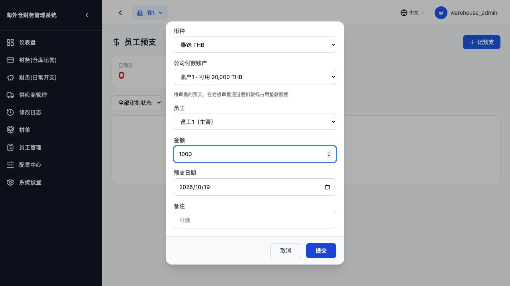
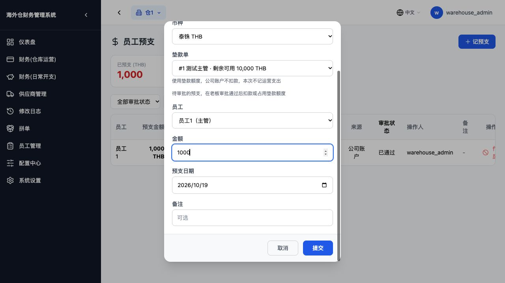
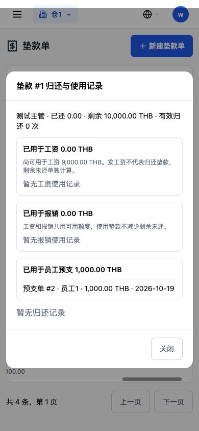
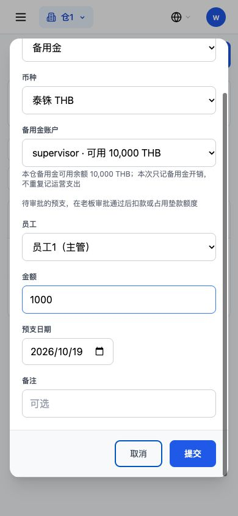

# 第八轮：预支资金来源验证报告

日期：2026-10-19。基线：3e19093。全部实操在本机临时隔离库完成，未连接生产、未部署。

## 资金规则

- 公司账户：仅已通过预支记“员工预支”运营支出，支出关联付款账户；余额和资金流水从同一事实记录计算，一笔只计一次。
- 垫款单：仅已通过预支占用可用额度，能反查预支单与金额；没有预支使用的旧垫款不增加空白使用区块。不记运营支出、不扣公司账户、不新增公司流水。不改变垫款的剩余未还。
- 备用金：仅已通过预支生成已审核、只记用途的备用金开销；可用余额随台账减少，不新增运营支出或公司流水。
- 用户已确认：待审批先不动资金、不占垫款额度，老板通过时重新校验并统一执行；待审批仍占原工资预支上限。驳回不产生资金动作。
- 每次新建、审批或作废由原请求事务提交；任一步失败整体回滚。审批、账户/垫款/备用金行锁防重复和超额，拿锁后强制刷新登记预检可能缓存的余额/状态；失败不留下半张员工档案或半笔账。

## 第一步至第三步：浏览器真实登记结果

同一测试仓，按顺序各登记 1,000 THB。初始公司现金账户 20,000，运营支出 0 笔/0 元，既有流水 2 条，垫款可用 10,000，备用金可用 10,000。

| 指标 | 公司账户预支后 | 随后垫款来源预支后 | 随后备用金来源预支后 |
| --- | ---: | ---: | ---: |
| 本次预支 | 1,000 THB | 1,000 THB | 1,000 THB |
| 运营支出笔数 | 1（新增1） | 1（不变） | 1（不变） |
| 运营支出合计 | 1,000 | 1,000 | 1,000 |
| 公司现金账户余额 | 19,000 | 19,000 | 19,000 |
| 公司资金流水条数 | 3（新增1） | 3（不变） | 3（不变） |
| 垫款用于员工预支 | 0 | 1,000 | 1,000 |
| 垫款剩余可用 | 10,000 | 9,000 | 9,000 |
| 垫款剩余未还 | 10,000 | 10,000 | 10,000 |
| 备用金可用余额 | 10,000 | 10,000 | 9,000 |

三笔预支编号分别为 1/2/3。公司账户那笔关联支出 #1、付款账户 #1；垫款那笔关联垫款 #1、支出为空；备用金那笔关联备用金账户 #1、支出为空。运营支出分类实际为“员工预支”，金额 1,000，备注包含员工名与预支单号；新流水携带所选账户，能在账户维度查询，且没有重复计入手工流水。

垫款列表实际显示“用于员工预支 1,000.00 泰铢”“可用 9,000.00”；历史里显示“预支单 #2 · 员工1 · 1,000.00 THB · 2026-10-19”。







## 第四步：实际拒绝返回

用同一个本地服务发送真实请求，三次均 HTTP 400，预支记录数与账目未变化：

```json
{"detail":"垫款单剩余金额不足"}
{"detail":"垫款单币种与预支不一致"}
{"detail":"请选择资金来源"}
```

另验证公司账户/备用金余额不足、缺账户、停用/未确认来源、跨仓库来源、审批时资源已变化、同一会话缓存对象期间另一会话已经用掉资金或还清垫款；错误请求和日志失败全部回滚。原来的权限规则保留，只有仓库管理员可审批和作废，劳工不能操作管理接口。

## 待审批实操

主管本人又登记预支 #4，资金来源垫款单，金额 1,000：状态待审批，垫款占用仍 1,000、可用仍 9,000；公司余额 19,000、成本 1笔/1,000、流水3条、备用金9,000均不变。

老板实际点通过后：#4变已通过，垫款占用2,000、可用8,000；上述公司资金、成本、流水和备用金数字仍不变。重复通过被拒，未重复占用。后端分别验证了公司账户、垫款、备用金的待审批/通过/驳回和审批失败回滚。

## 字段与迁移

`employee_advances` 新增三个可空字段：

| 字段 | 用途 |
| --- | --- |
| funding_source | company_account / cash_advance / expense_fund |
| cash_advance_id | 关联垫款单 |
| payment_account_id | 保存新建时选定的公司付款账户，供稍后审批使用 |

前两项是需求字段，第三项用于待审批时保留付款账户，避免审批时丢失选择。既有 `source`、`fund_account_id`、`fund_item_id` 等字段保留。

启动脚本 `_migrate_employee_advance_funding` 使用 `ADD COLUMN IF NOT EXISTS`，每列独立保存点；不执行历史回填。真实PostgreSQL验证重复执行、已加部分列、逐列失败后恢复，旧行仍全部NULL且原有金额、来源、审批和状态不变。

旧记录的来源留空，对外显示按公司账户理解，但不猜测原付款账户，不补扣余额、不补记资金或成本。老待审记录继续原支出关联规则，不伪造新来源的资金事实。旧预支工资抵扣仍有效：基础1,200、抵扣1,000、实发200，已有工资单不自动重算。

## 保留与联动

- 算工资的全部处理函数、确认/发放/重算等动作与基线AST一致；唯一新增的是工资垫款选择的只读可用额度，扣除已被预支占用的部分。工资发放是否记成本的路径没有修改。
- 原 `employee_advance_limit.py` 文件逐字未变；三来源合并计额度，待审也占用，已结清/已驳回/已作废仍按原规则排除。跨币种按原登记日汇率折泰铢校验，CNY→THB=5的混合来源边界已验证。
- 垫款可用额度同时扣除工资、报销和预支用量，防止从其他入口重复使用；报销实际付款动作不改。
- 作废沿用已有“只许老板、必须原因、已经随工资抵扣不能作废”规则。公司来源删除关联支出并恢复余额/流水，垫款来源释放用量，备用金来源删除精确关联开销、恢复可用额度，同事务留痕。
- 防止绕过预支作废：新备用金预支关联开销不能从备用金审核入口直接驳回退款；普通开销及历史记录保持原规则。
- 新付款账户引用阻止账户被删除或改币种，保留历史可核对性；停用仍按原账户流程操作，审批时会再检查是否可用。

## 手机与检查结果

手机390×844实操：三种来源可选；公司账户默认优先现金；垫款仅列同币种已确认单并显示剩余可用；备用金显示本仓同币种可用合计。弹框可滚动，底部按钮可见、可点并成功提交。缺来源或余额不足时提示中文，加载失败可重试；提交中禁重复点击。



- 271项后端及PostgreSQL检查全部通过，包含新迁移8项与既有汇率PostgreSQL检查；覆盖原预支登记、自动建档、审批、驳回、额度、作废、工资、垫款、备用金、报销和三张账。
- 早期预支测试请求已升级为必选资金来源，并提供有余额的测试账户；新备用金预支的断言改为不生成成本，保留原工资/报销处理函数的严格比较。
- 五套前端检查全部通过：新资金来源12场景、原选人15项、作废、工资发放23场景、垫款归还检查。
- Next生产构建成功，50个页面生成；项目原配置跳过类型与lint，不将构建当作独立类型/lint通过。
- 本轮没有部署；上线需配套前后端与上述启动加列迁移。生产记录和生产工资单未操作。

逐步数值及返回字段见[验收数据JSON](预支资金来源验收数据.json)。

## 已记下的后续事项

见[资金口径后续事项](资金口径后续事项.md)。当前仓库的归还垫款仍不记成本，须后续单独接入按用途记成本；工资使用垫款当前仍记成本，按用户要求留到独立轮次修正。本轮只完成预支资金来源，不擅自改工资或归还垫款的成本路径。报销垫款同样需在归还口径改变前统一核对。
